
Attitude estimation refers to the problem of finding the angular position of an object with respect to a global frame. Estimating attitude is a
fundamental task across many domains, from robotics to sports analytics.  For instance, in the autonomous navigation of a quadrotor, the first requirement is to stabilize the vehicle, which in turn demands precise knowledge of its attitude. Among the various sensing modalities available for attitude estimation, the most widely used is the
<em>Inertial Measurement Unit</em> (IMU). The core components of an IMU are gyroscopes, which measure the three-dimensional angular velocity of the object, and accelerometers, which measure the three-dimensional specific force acting on the object. 

 In this project, we designed and implemented four Kalman-type filters for the attitude estimation problem:

<ul>
  <li>Extended Kalman filter (EKF)</li>
  <li>Error State EKF (ESEKF)</li>
  <li>Unscented Kalman filter (UKF)</li>
  <li><strong>Enhanced EKF (EEKF)</strong></li>
</ul>

We proposed EEKF that keeps the filter statistically consistent by solving a small semidefinite program whenever its innovations look suspicious. We implement these filters on real-world data (EuRoC mav dataset) and on synthetic data (IMU plus magnetometer data).



<!-- The filters estimate the attitude quaternion together with the gyroscope and accelerometer biases. The gyroscope drives the prediction, while the accelerometer (gravity direction) and magnetometer (Earth’s magnetic field) provide the measurements. The ESEKF uses a minimal error-state formulation, which also makes it possible to benchmark the filters against the posterior Cramér–Rao bound. -->

## The Enhanced EKF

A filter is *consistent* when the uncertainty it reports matches the errors it actually makes. This can be checked online through the innovations. At time step $$k$$, the innovation $$z_k = y_k - h(\hat x_{k\mid k-1})$$ is the difference between the measurement and its prediction, and $$S_k = H_k P_{k\mid k-1} H_k^\top + R$$ is the innovation covariance predicted by the filter, where $$H_k$$ is the measurement Jacobian, $$P_{k\mid k-1}$$ the predicted state covariance and $$R$$ the measurement noise covariance. The normalized innovation squared (NIS) and its running average (ANIS) are

$$
\epsilon_k^2 = z_k^\top S_k^{-1} z_k,
\qquad
\bar\epsilon_k^2 = \frac{1}{k}\sum_{i=1}^{k} \epsilon_i^2 .
$$

For a consistent filter, $$\bar\epsilon_k^2$$ is approximately normal with mean $$n_y$$ (the measurement dimension) and variance $$2n_y/k$$, so with $$95\%$$ confidence it stays in the band

$$
n_y - 2\sqrt{2n_y/k} \;\le\; \bar\epsilon_k^2 \;\le\; n_y + 2\sqrt{2n_y/k} .
$$

Since $$\bar\epsilon_k^2 = \big((k-1)\,\bar\epsilon_{k-1}^2 + \epsilon_k^2\big)/k$$, this band translates into bounds $$\bar\tau_l \le \epsilon_k^2 \le \bar\tau_u$$ on the current NIS, with

$$
\bar\tau_u = k\Big(n_y + 2\sqrt{2n_y/k}\Big) - (k-1)\,\bar\epsilon_{k-1}^2
$$

and $$\bar\tau_l$$ defined in the same way with a minus sign. When the EKF becomes overconfident, $$\epsilon_k^2$$ exceeds $$\bar\tau_u$$. The EEKF then replaces $$R$$ with a new matrix $$X$$ chosen so that $$z_k^\top (H_k P_{k\mid k-1} H_k^\top + X)^{-1} z_k \le \bar\tau_u$$. By a Schur complement, this condition is a linear matrix inequality in $$X$$, so $$X$$ is found by solving a small semidefinite program at that time step:

$$
\begin{bmatrix} H_k P_{k\mid k-1} H_k^\top + X & z_k \\ z_k^\top & \bar\tau_u \end{bmatrix} \succeq 0,
\qquad X \succ 0 .
$$

A typical result is shown below for heavy-tailed (Student’s-t) magnetometer noise. The black lines show the ideal ANIS mean and its $$95\%$$ band; the colored line and shaded region show each filter’s empirical mean and $$95\%$$ spread. For the EKF, ESEKF and UKF the spread is far wider than the ideal band, whereas the EEKF’s spread closely matches it. Its mean sits slightly below the ideal value because the lower bound of the test is not enforced.

  <figure>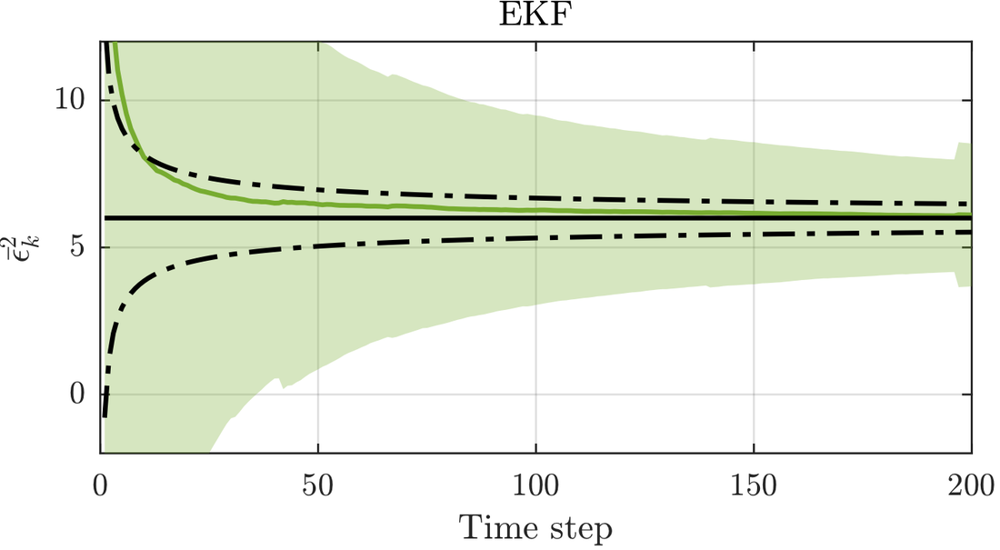<figcaption>EKF</figcaption></figure>
  <figure>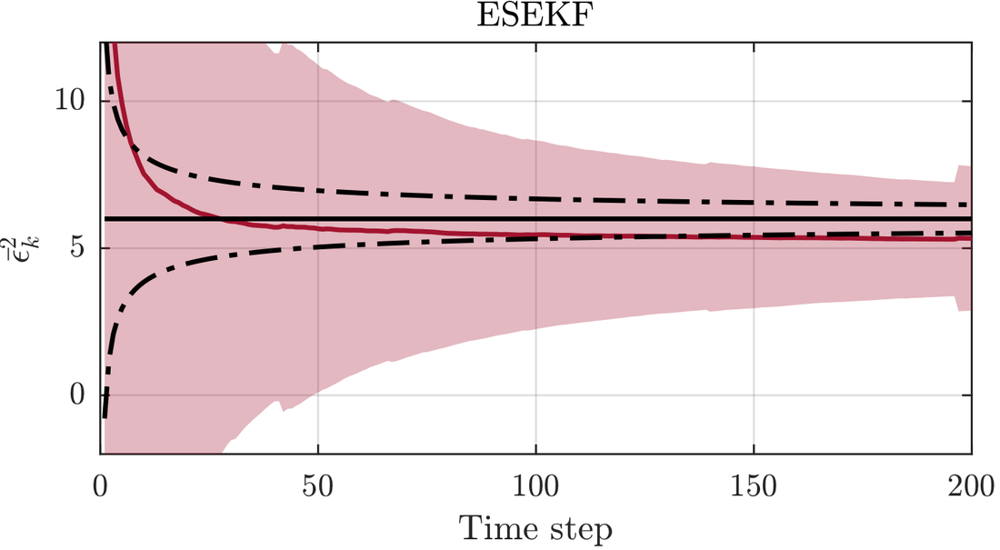<figcaption>ESEKF</figcaption></figure>
  <figure>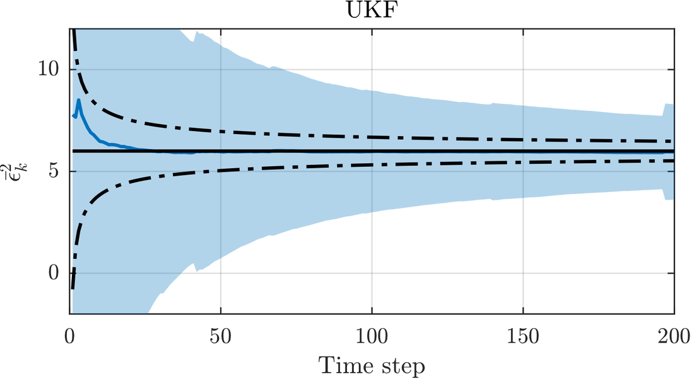<figcaption>UKF</figcaption></figure>
  <figure>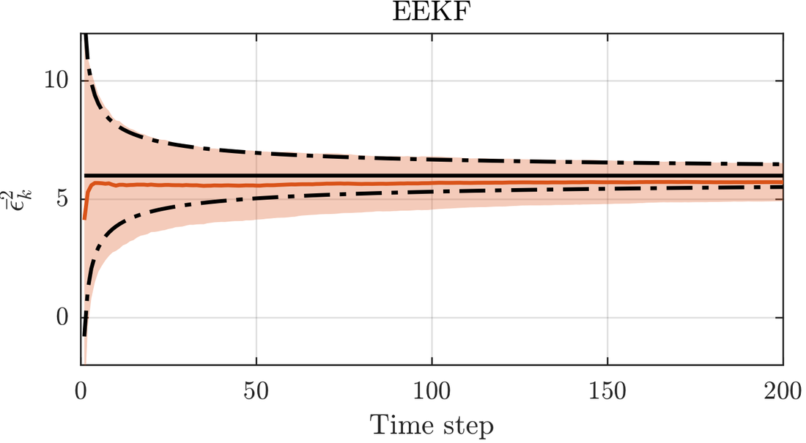<figcaption>EEKF</figcaption></figure>

Click any figure to enlarge it.

**Limitations.** The lower bound of the consistency test is non-convex, so it is currently dropped: the EEKF corrects overconfidence but not underconfidence. Solving a semidefinite program at each corrected step is also computationally expensive, especially when the underlying EKF is often inconsistent, which limits its use on resource-constrained hardware.

## Results on real flight data

On the EuRoC MAV dataset, which provides IMU data and motion-capture ground truth from a drone flying indoors but no magnetometer, yaw is unobservable and none of the filters can track it. Pitch and roll show chattering, and the EKF and UKF become inconsistent, because the drone’s abrupt maneuvers violate the assumption that body acceleration is negligible compared with gravity; the EEKF stays consistent. Removing the body acceleration from the data confirms this: the chattering disappears and all filters become consistent.

  

    <button type="button" data-tab="raw">Raw IMU data</button>
    <button type="button" data-tab="noacc">Body acceleration removed</button>
  

  

    

      <figure>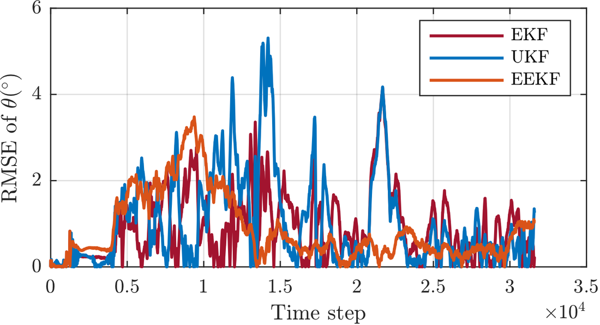<figcaption>Pitch error: chattering</figcaption></figure>
      <figure>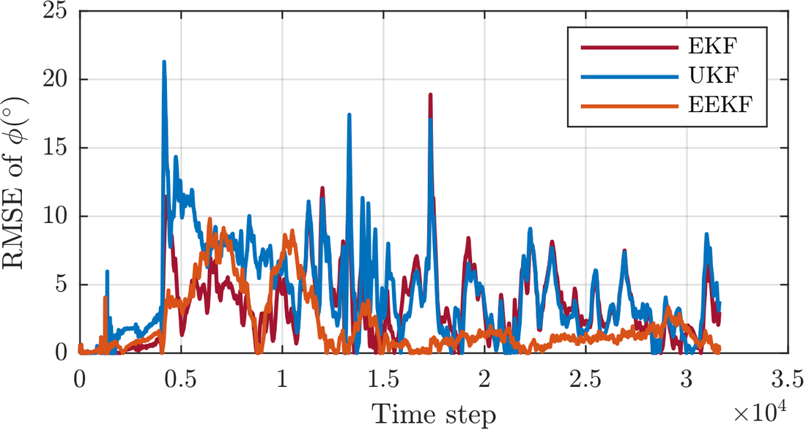<figcaption>Roll error: chattering</figcaption></figure>
      <figure>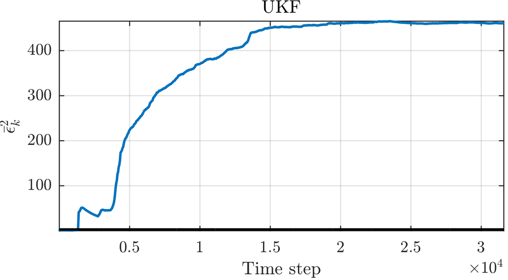<figcaption>UKF consistency</figcaption></figure>
      <figure>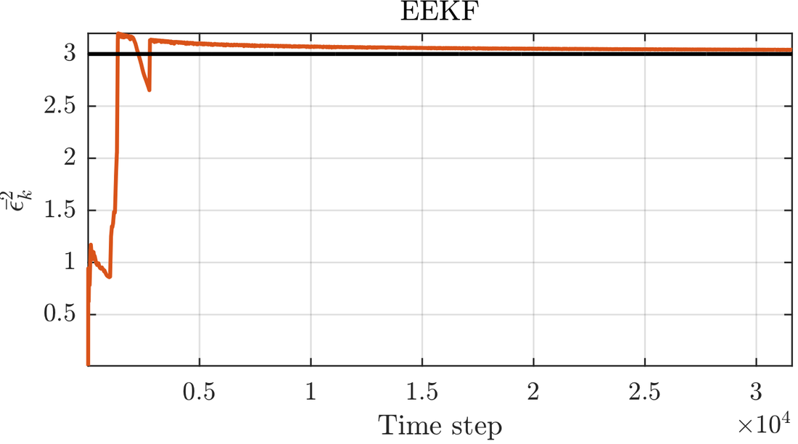<figcaption>EEKF consistency</figcaption></figure>
    

  

  

    

      <figure>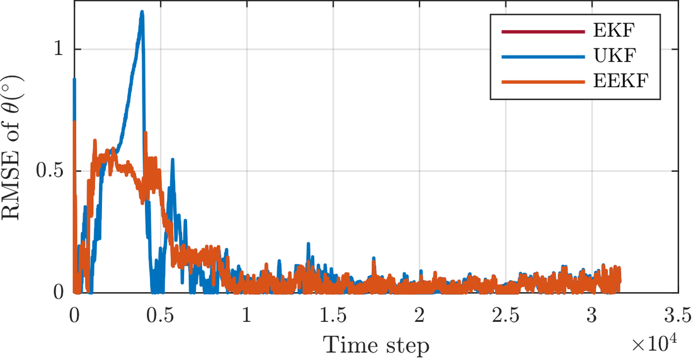<figcaption>Pitch error: no chattering</figcaption></figure>
      <figure>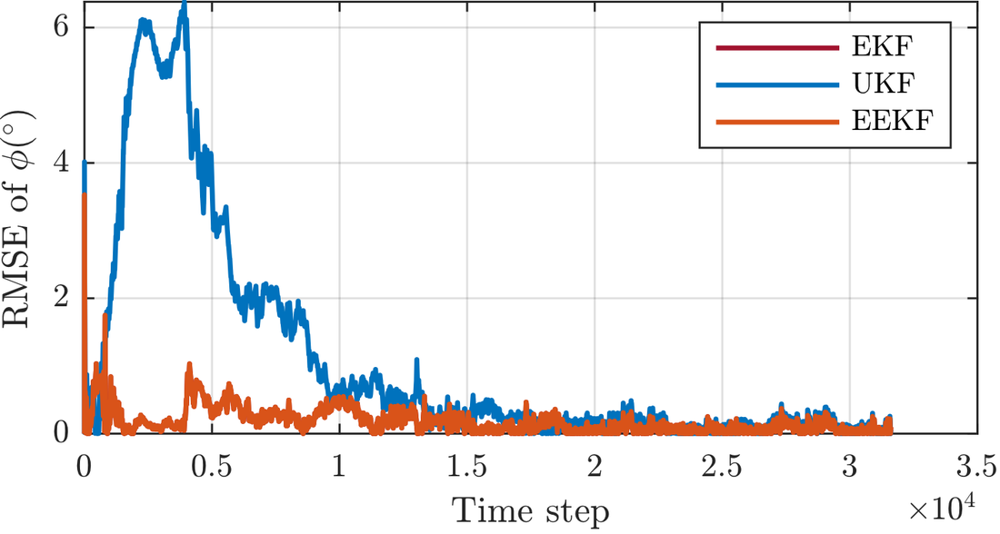<figcaption>Roll error: no chattering</figcaption></figure>
      <figure>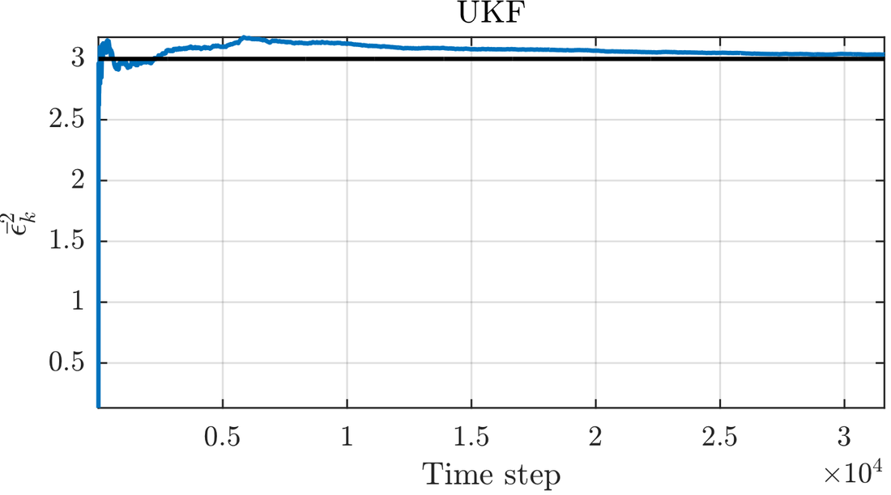<figcaption>UKF consistency</figcaption></figure>
      <figure>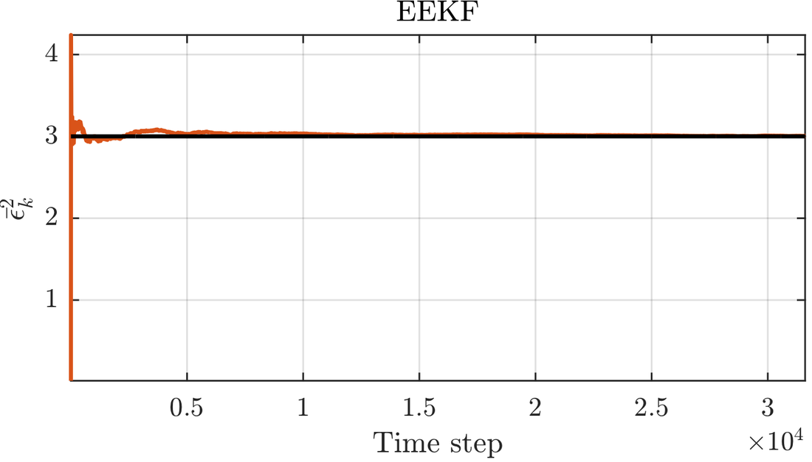<figcaption>EEKF consistency</figcaption></figure>
    

  

For the simulation results under Gaussian and heavy-tailed noise, comparisons with the posterior Cramér–Rao bound, filter efficiency, computation times and further discussion, see the [full report](report.pdf).

## Takeaways

- Enforcing consistency through convex optimization gives a filter that is both accurate and statistically trustworthy, at a computational price that depends on how often the base filter is inconsistent.
- The negligible-acceleration assumption is critical; in practice, full pose estimation (position and orientation) avoids it and yields better attitude estimates.
- Natural next steps are a convex relaxation of the lower consistency bound and replacing the feasibility problem with an optimization objective.


=====================================================================
HIDDEN (not shown on the website): your previous version of the rest
of the page, kept unchanged. Move any part above this block to show it.
=====================================================================

<!-- <dl class="project-glance">
  <dt>Goal</dt><dd>Estimate the orientation (attitude) of a rigid body together with the gyroscope and accelerometer biases.</dd>
  <dt>Sensors</dt><dd>Gyroscope, accelerometer and magnetometer.</dd>
  <dt>Filters</dt><dd>EKF, UKF, error-state EKF (ESEKF) and the proposed Enhanced EKF (EEKF).</dd>
  <dt>Scenarios</dt><dd>Synthetic data with Gaussian or heavy-tailed Student’s-t magnetometer noise; real flight data from the EuRoC MAV dataset.</dd>
  <dt>Benchmarks</dt><dd>Posterior Cramér–Rao bound (PCRB), filter efficiency and consistency (ANIS) tests.</dd>
</dl> -->

<!-- ## The problem

Attitude is the angular position of a body frame relative to a global frame. It is the first thing a quadrotor needs to know to stabilize itself, and it is also central to motion analysis and virtual reality. Gyroscopes measure angular velocity, accelerometers measure specific force (dominated by gravity when the body is not accelerating), and magnetometers measure the direction of Earth’s magnetic field, which pins down the heading.

The state contains the unit quaternion and the two sensor biases,

$$
x = \begin{bmatrix} q^\top & b_g^\top & b_a^\top \end{bmatrix}^\top \in \mathbb{R}^{10},
$$

the gyroscope drives the prediction step, and the accelerometer and magnetometer readings form the measurement:

$$
y_k = \begin{bmatrix} -R_k^\top g^G + b_{a,k} \\ R_k^\top m^G \end{bmatrix} + \begin{bmatrix} n_a \\ n_t \end{bmatrix}.
$$ -->

<!-- ## Two formulations

- **Quaternion state** (used by the EKF, UKF and EEKF). This is the most common formulation, but the gyroscope noise enters non-additively and lives in a lower-dimensional space than the quaternion, so the transition density is singular and the PCRB cannot be computed.
- **Error state** (used by the ESEKF). The attitude is written as a nominal quaternion times a small rotation error, giving a minimal 9-dimensional error state with additive noise. This makes the PCRB computable and gives a natural benchmark.

## The Enhanced EKF

A consistent filter’s average normalized innovation squared (ANIS) should stay inside a known confidence band around the measurement dimension. When the EKF is overconfident, its innovations fall outside that band. The EEKF detects this and replaces the measurement covariance \\(R\\) by a new matrix \\(X\\) that restores the upper bound. Using a Schur complement, the upper-bound condition becomes a linear matrix inequality, so \\(X\\) is found by solving a small semidefinite program (with MOSEK) at that time step:

$$
\begin{bmatrix} H_k P_{k\mid k-1} H_k^\top + X & z_k \\ z_k^\top & \bar\tau_u \end{bmatrix} \succeq 0,
\qquad X \succ 0 .
$$ -->

<!-- 

**Limitations.** The lower bound of the consistency test is non-convex, so it is currently dropped. The EEKF therefore only corrects overconfidence, not underconfidence, and solving an SDP at every corrected step is costly on resource-constrained hardware.

 -->

## Results on synthetic data

Each filter was run on 200-step simulated trajectories in two settings. Switch between them to compare.

  

    <button type="button" data-tab="gaussian">Gaussian noise</button>
    <button type="button" data-tab="student">Student’s-t noise (ν = 3)</button>
  

  

    <h4>Attitude error (RMSE)</h4>
    

      <figure>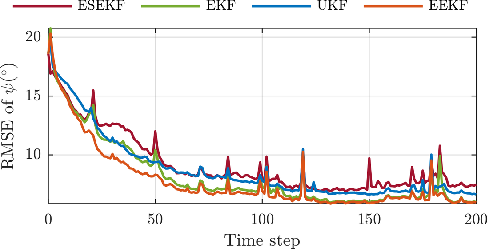<figcaption>Yaw ψ</figcaption></figure>
      <figure>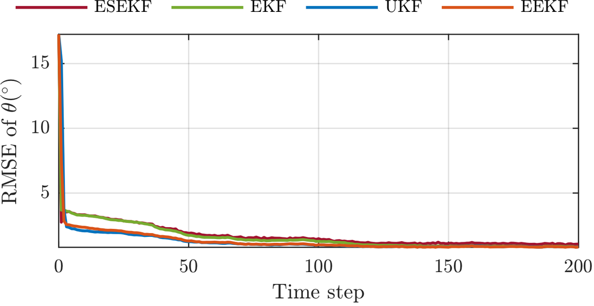<figcaption>Pitch θ</figcaption></figure>
      <figure>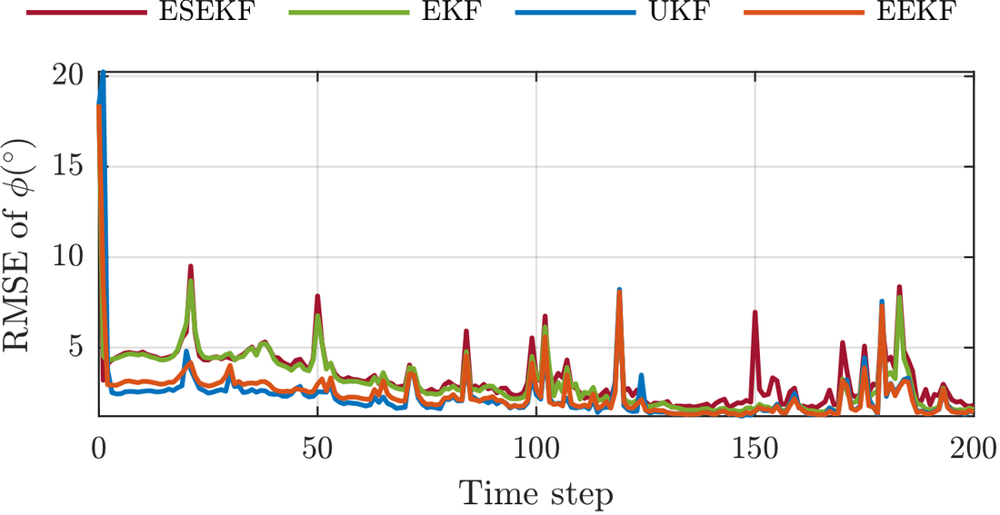<figcaption>Roll φ</figcaption></figure>
    

    <h4>Consistency (ANIS with 95% band)</h4>
    

      <figure>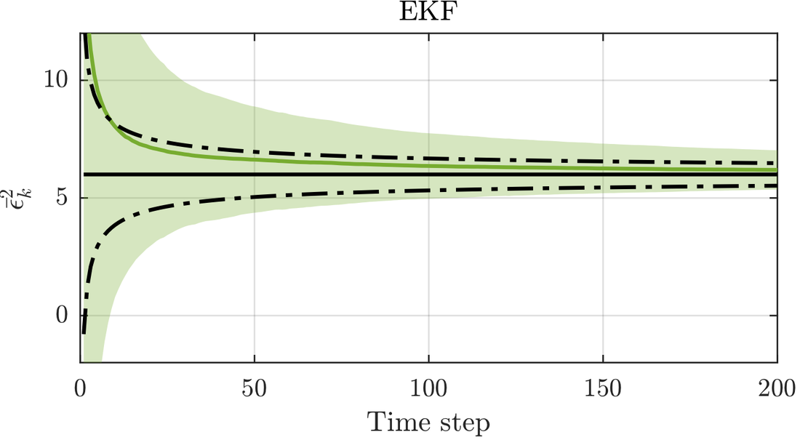<figcaption>EKF</figcaption></figure>
      <figure>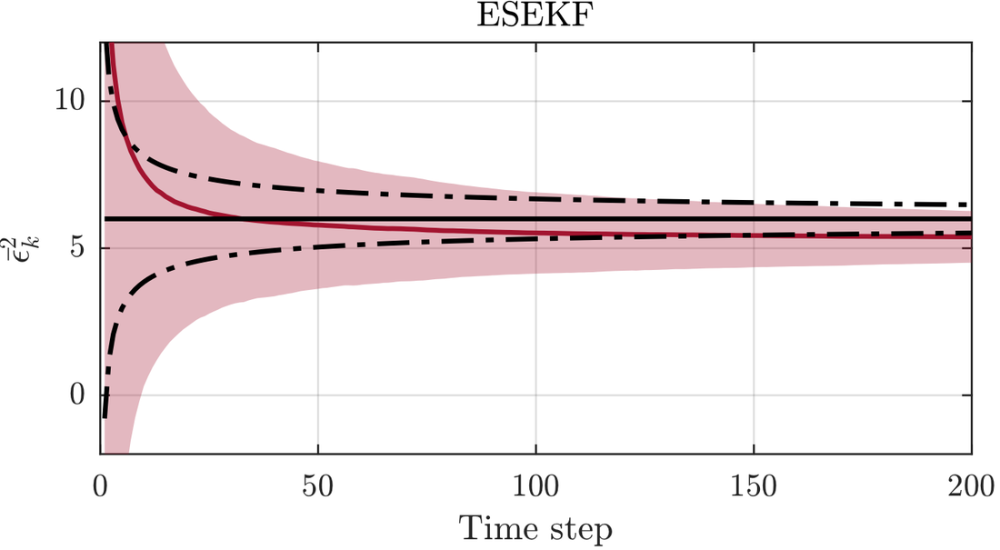<figcaption>ESEKF</figcaption></figure>
      <figure>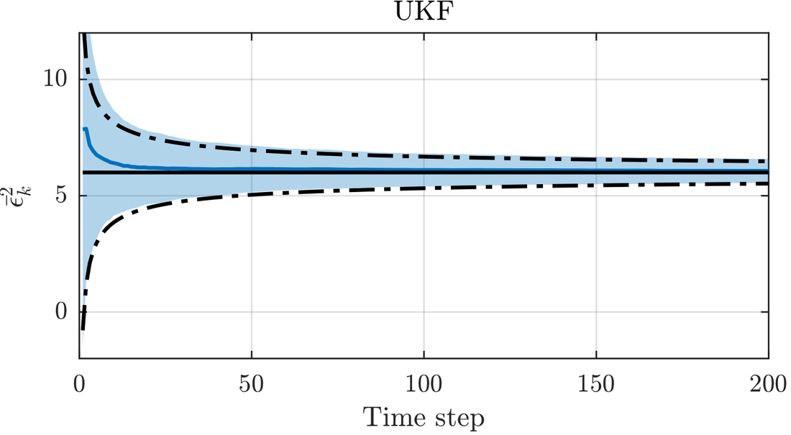<figcaption>UKF</figcaption></figure>
      <figure>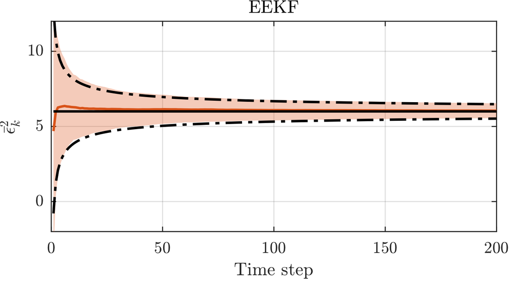<figcaption>EEKF</figcaption></figure>
    

    <h4>Bound and efficiency</h4>
    

      <figure>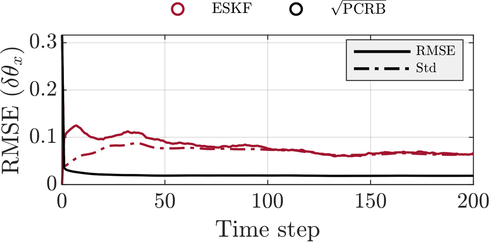<figcaption>ESEKF vs. √PCRB</figcaption></figure>
      <figure>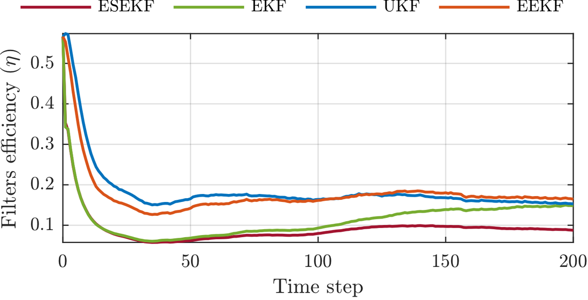<figcaption>Filter efficiency</figcaption></figure>
    

  

  

    <h4>Attitude error (RMSE)</h4>
    

      <figure>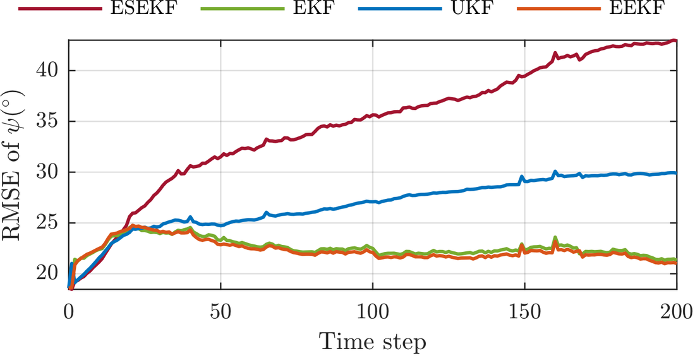<figcaption>Yaw ψ</figcaption></figure>
      <figure>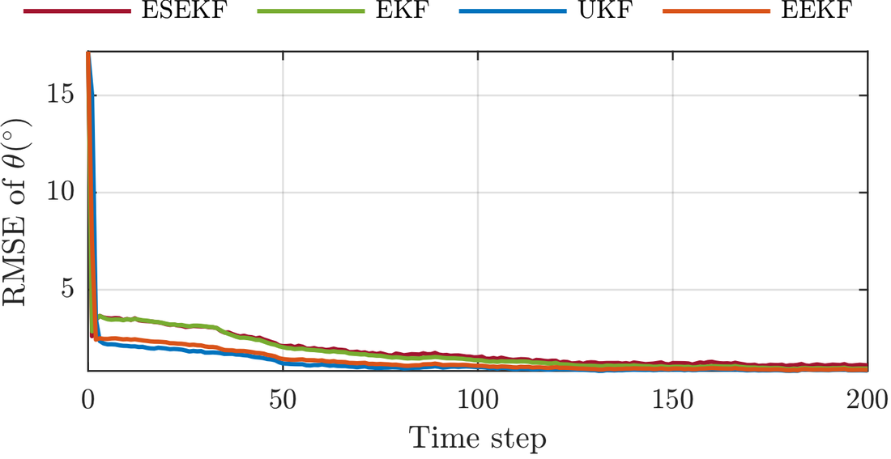<figcaption>Pitch θ</figcaption></figure>
      <figure>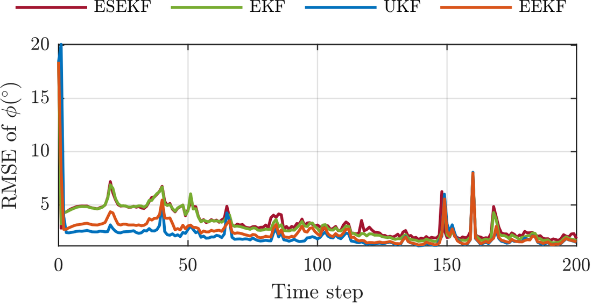<figcaption>Roll φ</figcaption></figure>
    

    <h4>Consistency (ANIS with 95% band)</h4>
    

      <figure><figcaption>EKF</figcaption></figure>
      <figure><figcaption>ESEKF</figcaption></figure>
      <figure><figcaption>UKF</figcaption></figure>
      <figure><figcaption>EEKF</figcaption></figure>
    

    <h4>Bound and efficiency</h4>
    

      <figure>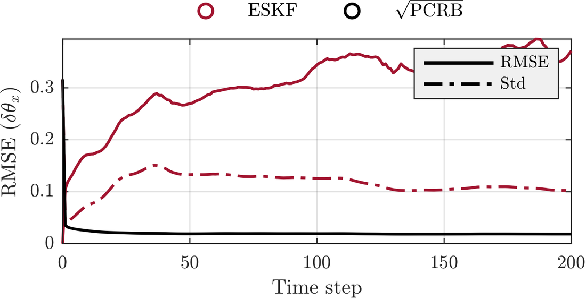<figcaption>ESEKF vs. √PCRB</figcaption></figure>
      <figure>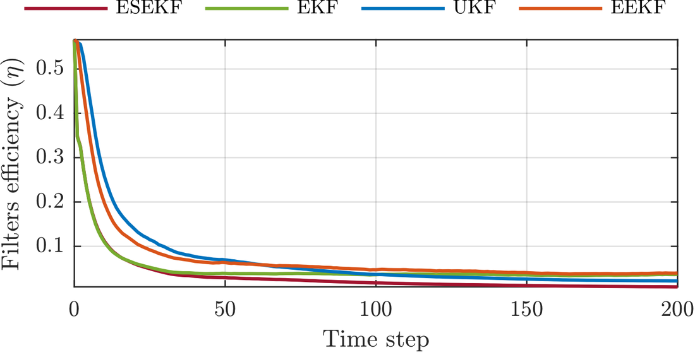<figcaption>Filter efficiency</figcaption></figure>
    

  

- With Gaussian noise, the **EEKF and UKF achieve the lowest attitude error**, and the EEKF is the most efficient filter while remaining consistent.
- With heavy-tailed magnetometer noise (approximated by a Gaussian through moment matching), all filters degrade, and **yaw degrades the most**, since the magnetometer is the main source of heading information.
- The EEKF’s ANIS can fall below the ideal value under heavy-tailed noise, a direct consequence of dropping the lower consistency bound.

<table class="project-table">
  <thead><tr><th>Average time per step</th><th>EKF</th><th>ESEKF</th><th>UKF</th><th>EEKF</th></tr></thead>
  <tbody><tr><td>Synthetic data (ms)</td><td>0.024</td><td>0.043</td><td>0.35</td><td>0.11</td></tr></tbody>
</table>

## Results on real flight data

The filters were also run on the EuRoC MAV dataset, which provides IMU data and motion-capture ground truth from a micro aerial vehicle flying indoors, but no magnetometer.

  

    <button type="button" data-tab="raw">Raw IMU data</button>
    <button type="button" data-tab="noacc">Body acceleration removed</button>
  

  

    <h4>Attitude error (RMSE)</h4>
    

      <figure>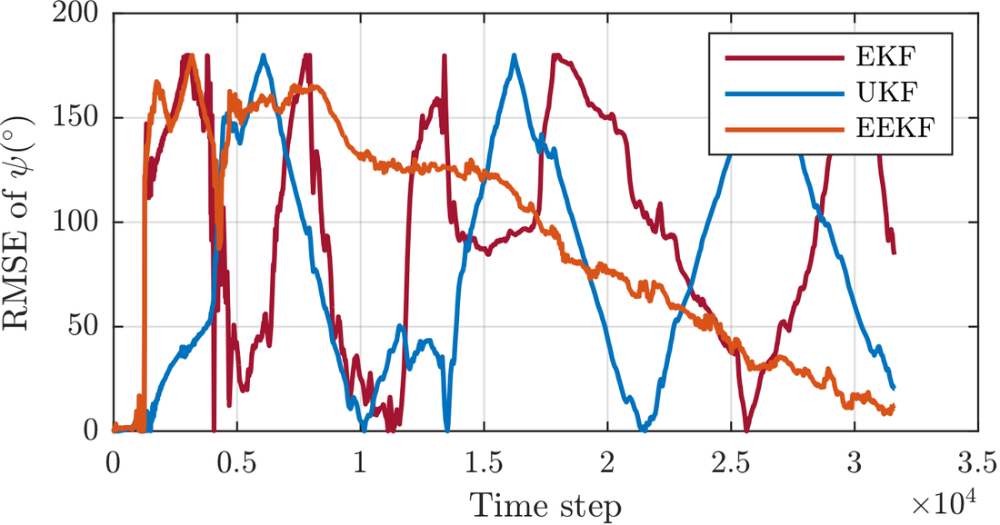<figcaption>Yaw ψ</figcaption></figure>
      <figure><figcaption>Pitch θ</figcaption></figure>
      <figure><figcaption>Roll φ</figcaption></figure>
    

    <h4>Consistency (ANIS)</h4>
    

      <figure>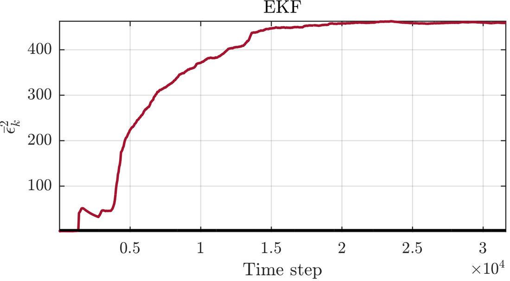<figcaption>EKF</figcaption></figure>
      <figure><figcaption>UKF</figcaption></figure>
      <figure><figcaption>EEKF</figcaption></figure>
    

  

  

    <h4>Attitude error (RMSE)</h4>
    

      <figure>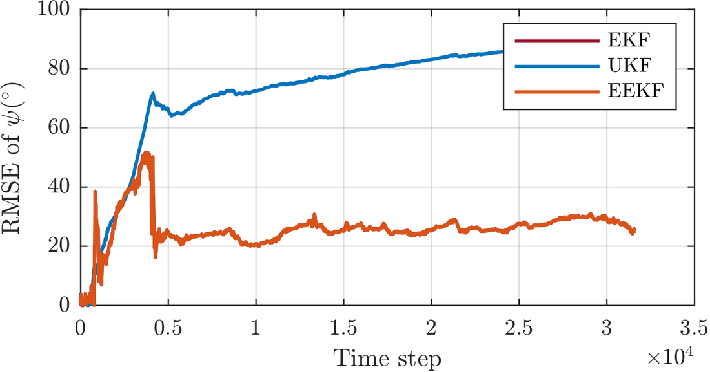<figcaption>Yaw ψ</figcaption></figure>
      <figure><figcaption>Pitch θ</figcaption></figure>
      <figure><figcaption>Roll φ</figcaption></figure>
    

    <h4>Consistency (ANIS)</h4>
    

      <figure>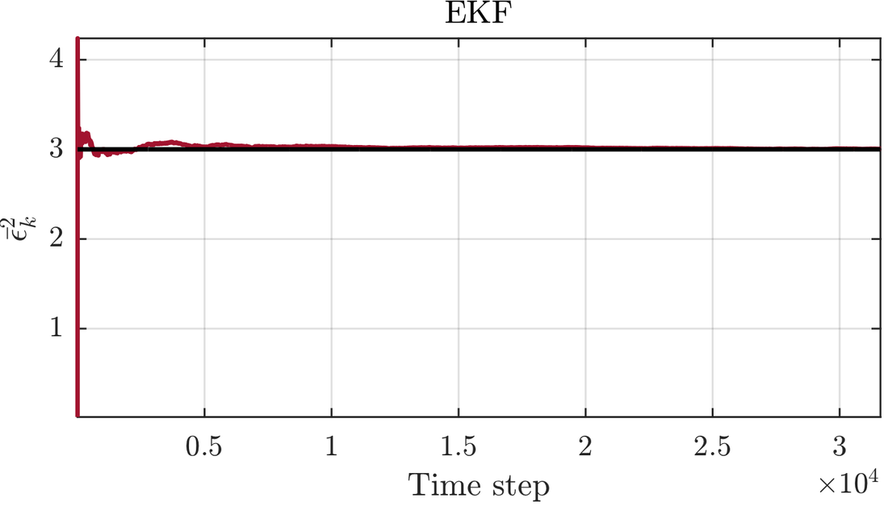<figcaption>EKF</figcaption></figure>
      <figure><figcaption>UKF</figcaption></figure>
      <figure><figcaption>EEKF</figcaption></figure>
    

  

- **Yaw is unobservable** with only an IMU, so all filters fail to track it without a magnetometer.
- Pitch and roll show **chattering**, and the EKF and UKF become inconsistent, because the drone’s abrupt maneuvers violate the assumption that body acceleration is negligible compared with gravity. The **EEKF stays consistent**.
- Removing the body acceleration from the data confirms this: the chattering disappears, all filters become consistent, and the EEKF and EKF coincide.

<table class="project-table">
  <thead><tr><th>Average time per step</th><th>EKF</th><th>UKF</th><th>EEKF</th></tr></thead>
  <tbody><tr><td>EuRoC data (ms)</td><td>0.060</td><td>0.46</td><td>94.9</td></tr></tbody>
</table>

The EEKF is expensive here because it must repeatedly correct a highly inconsistent EKF by solving an SDP.

## Takeaways

- Enforcing consistency through convex optimization gives a filter that is both accurate and statistically trustworthy, at a computational price that depends on how often the base filter is inconsistent.
- The negligible-acceleration assumption is critical; in practice, full pose estimation (position and orientation) avoids it and yields better attitude estimates.
- Natural next steps are a convex relaxation of the lower consistency bound and replacing the feasibility problem with an optimization objective.

