
Physical systems come with limits: a joint can only turn so far, a motor can only spin so fast, a vehicle must stay in its lane. A controller that tracks a reference well but occasionally violates such limits is not acceptable. In this project, I studied an adaptive controller that guarantees <strong>all states stay within given bounds</strong>, even when the system parameters are unknown and even when the <strong>sign of the control gain is unknown</strong>, so the controller does not know in which direction its input pushes the system. I reproduced the design of Liu and Tong for symmetric and asymmetric constraints, and extended it to an <strong>external disturbance</strong> and an <strong>input delay</strong>.

## Barrier Lyapunov functions

The systems considered are in strict-feedback form,

$$
\dot x_i = \vartheta_i^\top \varphi_i(x_1, \dots, x_i) + \phi_i\, x_{i+1}, \qquad \dot x_n = \vartheta_n^\top \varphi_n(x) + \phi_n\, u, \qquad y = x_1,
$$

where the parameters $$\vartheta_i$$ and the gains $$\phi_i$$ are unknown, including their signs, and every state must satisfy $$\lvert x_i \rvert < k_{c,i}$$. The controller is designed by backstepping. At each step $$i$$, an error $$\epsilon_i$$ (between the state and its desired value) is kept inside the interval $$\lvert \epsilon_i \rvert < k_{b,i}$$ with a **barrier Lyapunov function**

$$
V_i = \frac{1}{2} \log \frac{k_{b,i}^2}{k_{b,i}^2 - \epsilon_i^2} + \frac{1}{2}\, \tilde\vartheta_i^\top \Gamma_i^{-1} \tilde\vartheta_i ,
$$

which grows without bound as the error approaches its limit. As long as $$V_i$$ stays bounded, the error can never reach the barrier, and with suitable widths $$k_{b,i}$$ the states never leave their bounds. The unknown parameters are estimated with adaptation laws, and the unknown control directions are handled with a **Nussbaum gain** $$N(\zeta) = \zeta^2 \cos \zeta$$, a function that oscillates with growing amplitude, so the controller can search for the right direction while the barrier keeps the errors bounded. With an **asymmetric** barrier, the error is allowed to move a different distance on each side, $$-k_{a,i} < \epsilon_i < k_{b,i}$$.

## Simulations

The example system is

$$
\dot x_1 = 0.1 x_1^2 + \phi_1 x_2, \qquad \dot x_2 = 0.2 x_1 x_2 + x_1 + \phi_2 u,
$$

with $$\phi_1 = -1$$ and $$\phi_2 = 2$$, unknown to the controller. The output must track $$y_r = 0.5 \cos(0.5 t)$$ while $$\lvert x_1 \rvert < 0.8$$ and $$\lvert x_2 \rvert < 2$$. In the third case, the system also has the external disturbance $$0.15 \lvert \sin(0.1 x_2) \rvert$$ in the first equation and an input delay of $$\tau = 0.02$$ s.

  

    <button type="button" data-tab="sym">Symmetric barrier</button>
    <button type="button" data-tab="asym">Asymmetric barrier</button>
    <button type="button" data-tab="dist">Disturbance and delay</button>
  

  

    

      <figure>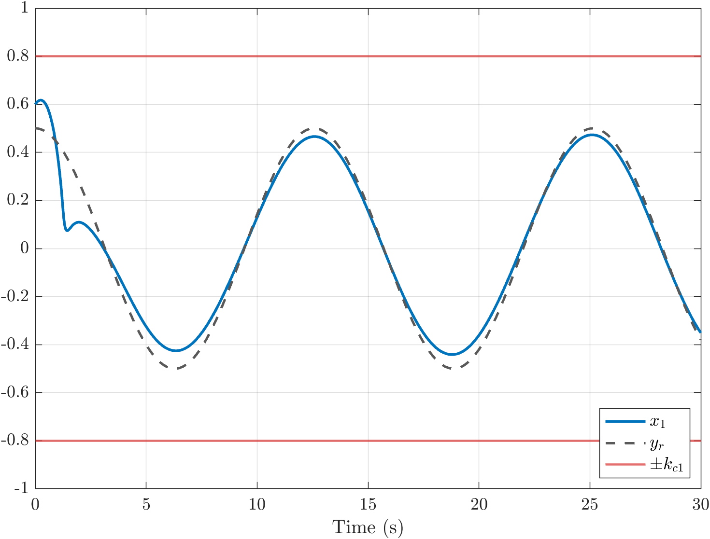<figcaption>Output and reference</figcaption></figure>
      <figure>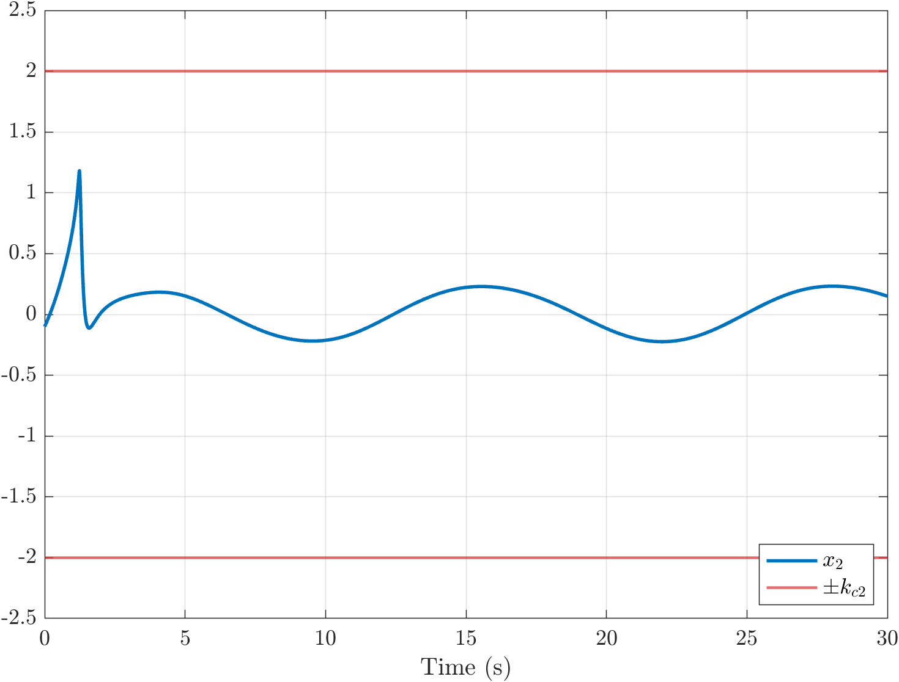<figcaption>Second state</figcaption></figure>
      <figure>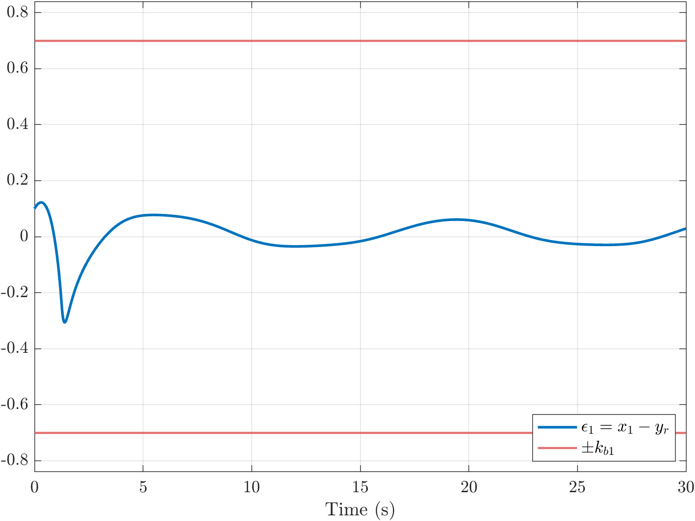<figcaption>Tracking error and its barrier</figcaption></figure>
      <figure>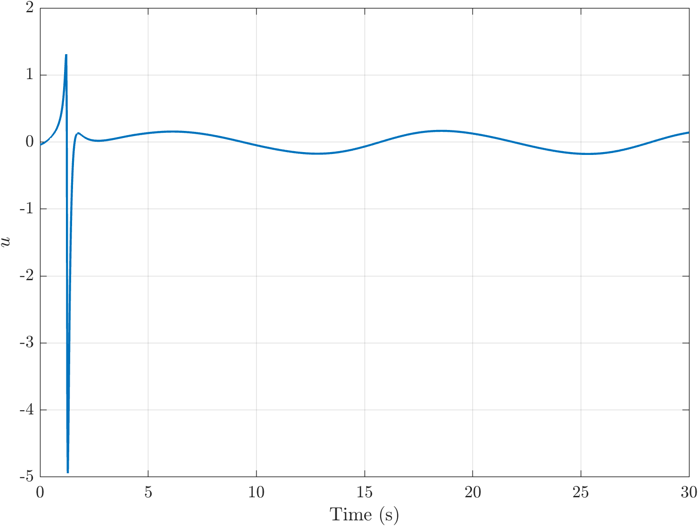<figcaption>Control input</figcaption></figure>
    

  

  

    

      <figure>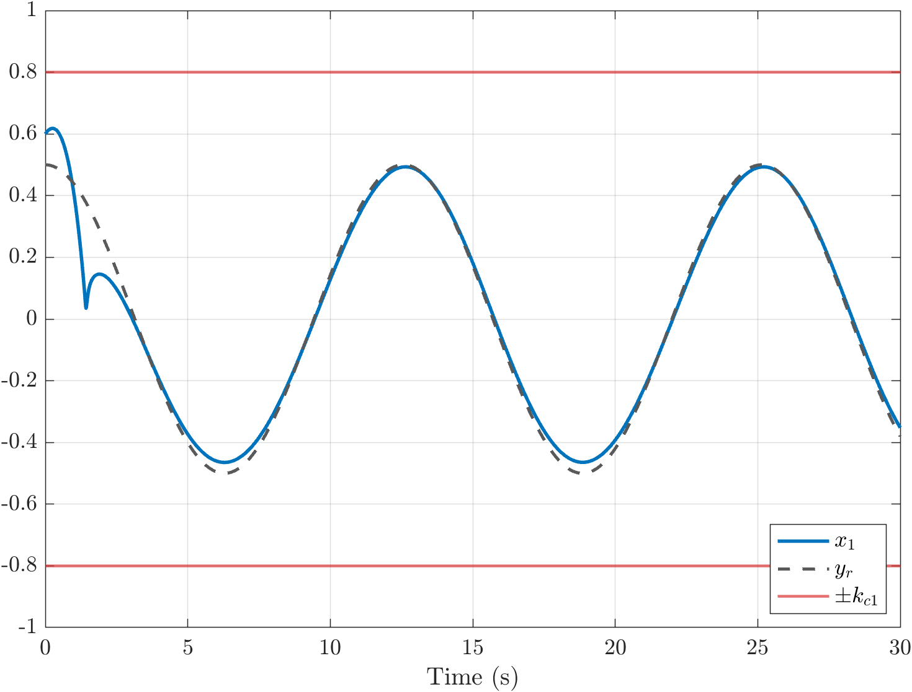<figcaption>Output and reference</figcaption></figure>
      <figure>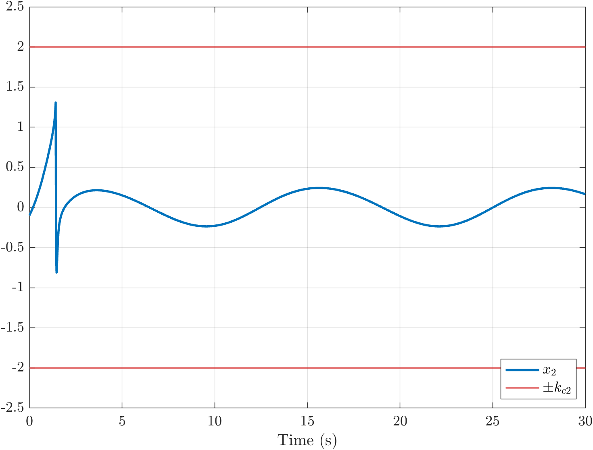<figcaption>Second state</figcaption></figure>
      <figure>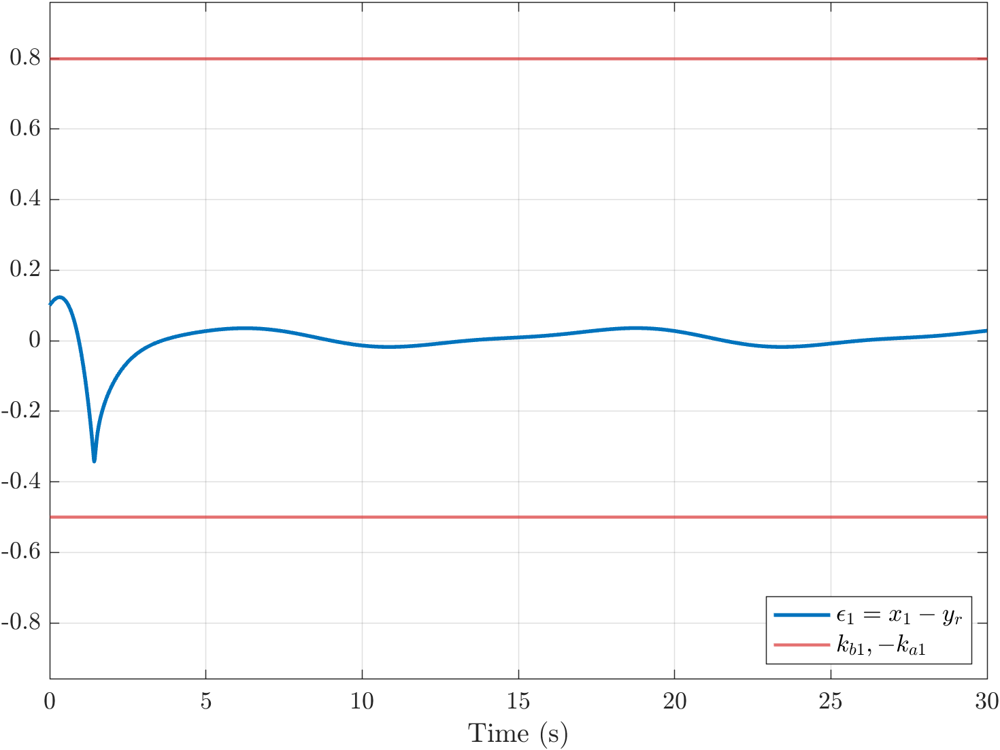<figcaption>Tracking error and its asymmetric barrier</figcaption></figure>
      <figure>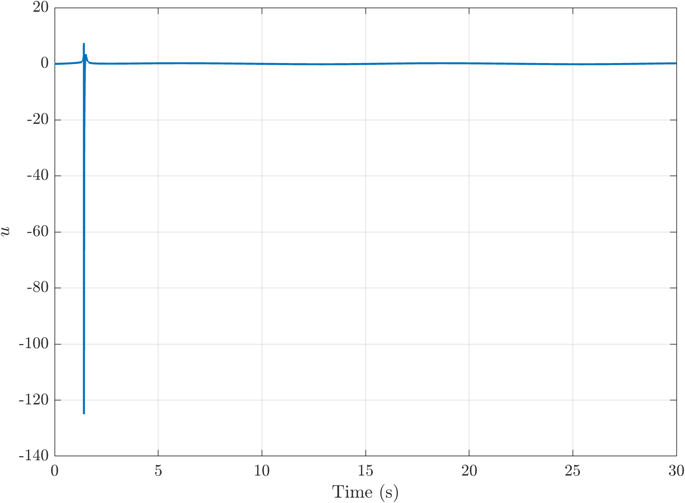<figcaption>Control input</figcaption></figure>
    

  

  

    

      <figure>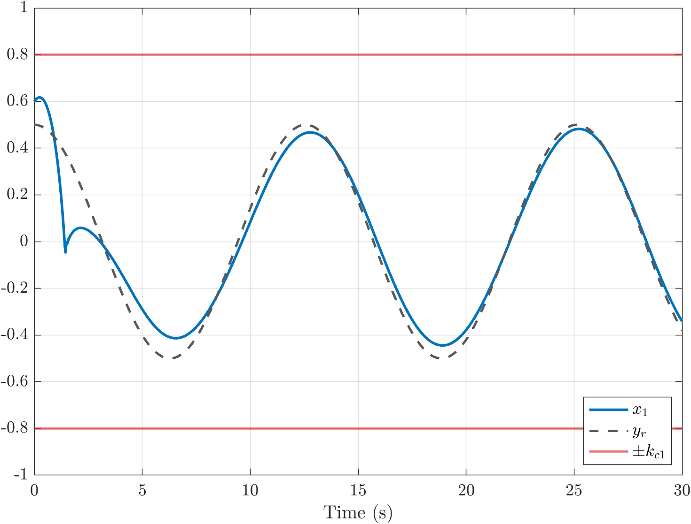<figcaption>Output and reference</figcaption></figure>
      <figure><figcaption>Second state</figcaption></figure>
      <figure>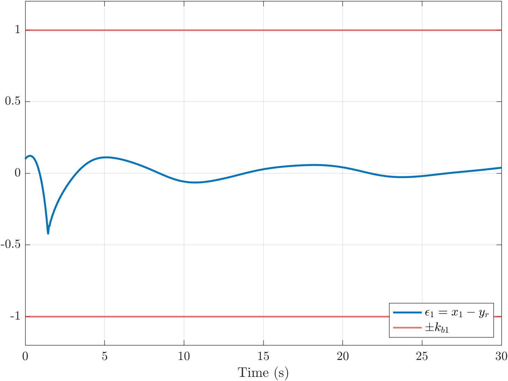<figcaption>Tracking error and its barrier</figcaption></figure>
      <figure>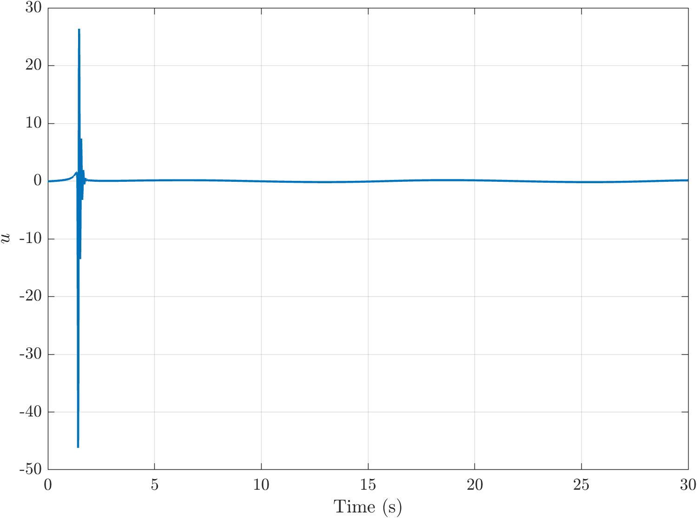<figcaption>Control input</figcaption></figure>
    

  

Red lines are the constraints. Click any figure to enlarge it.

In all three cases, the output follows the reference and both states stay well within their bounds. The large spikes in the control input near $$t = 1.3$$ s come from the Nussbaum gain adapting while it searches for the control direction.

## Disturbance and input delay

To handle a bounded external disturbance $$\lvert d_i \rvert \le D_i$$, I added a damping term to each virtual control, derived with Young’s inequality, so that the disturbance only adds a bounded term to the derivative of the barrier Lyapunov function and the errors stay inside their barriers. This works well: the controller tracks the reference with the disturbance present, as in the third tab.

The input delay turned out to be much harder. Simulating the controller for a range of delays showed that it keeps the states within their bounds only for delays up to about $$\tau = 0.02$$ s. Beyond that, the second error grows into its barrier during the first second and a half, while the Nussbaum gain is still too small to correct it. I also tried compensating the delay with a first-order Padé approximation, $$u(t - \tau) \approx x_p - u$$ with $$\dot x_p = -\lambda x_p + 2\lambda u$$ and $$\lambda = 2/\tau$$. This made things worse: the Padé approximation is non-minimum phase, so its instantaneous gain has the opposite sign of its steady-state gain, which conflicts with the search for the control direction. A proper treatment of the delay would need a different design, such as an additional backstepping step or a predictor.

## Takeaways

- Barrier Lyapunov functions turn state constraints into a guarantee: the errors, and with suitable barrier widths the states, can never cross their bounds.
- Nussbaum gains let an adaptive controller work without knowing the direction of its own input, at the cost of large transients while it searches for that direction.
- Bounded disturbances are handled well, but input delays interact badly with the direction search, and a simple Padé compensation is not enough.
