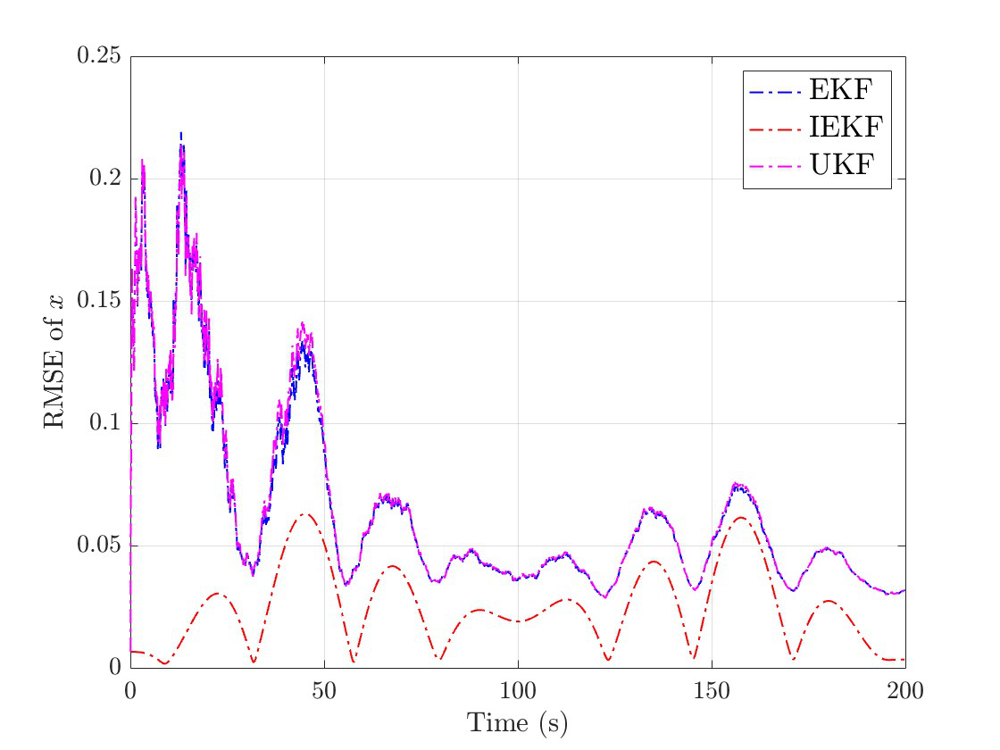
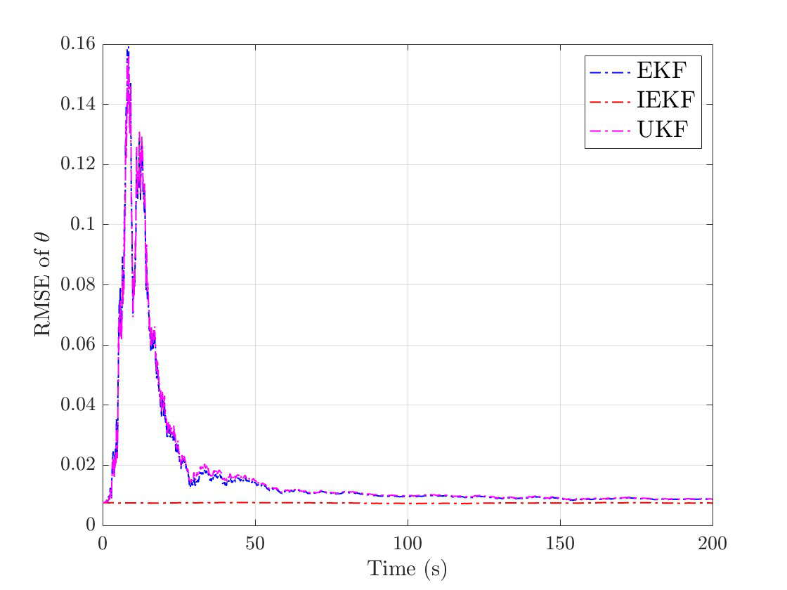
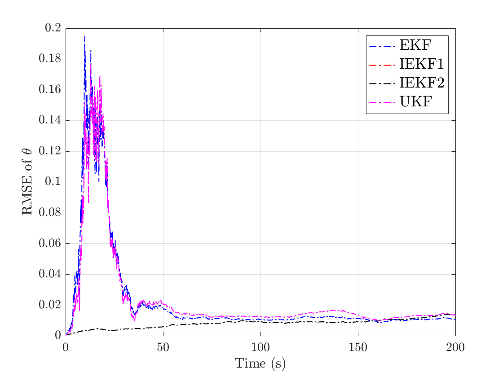
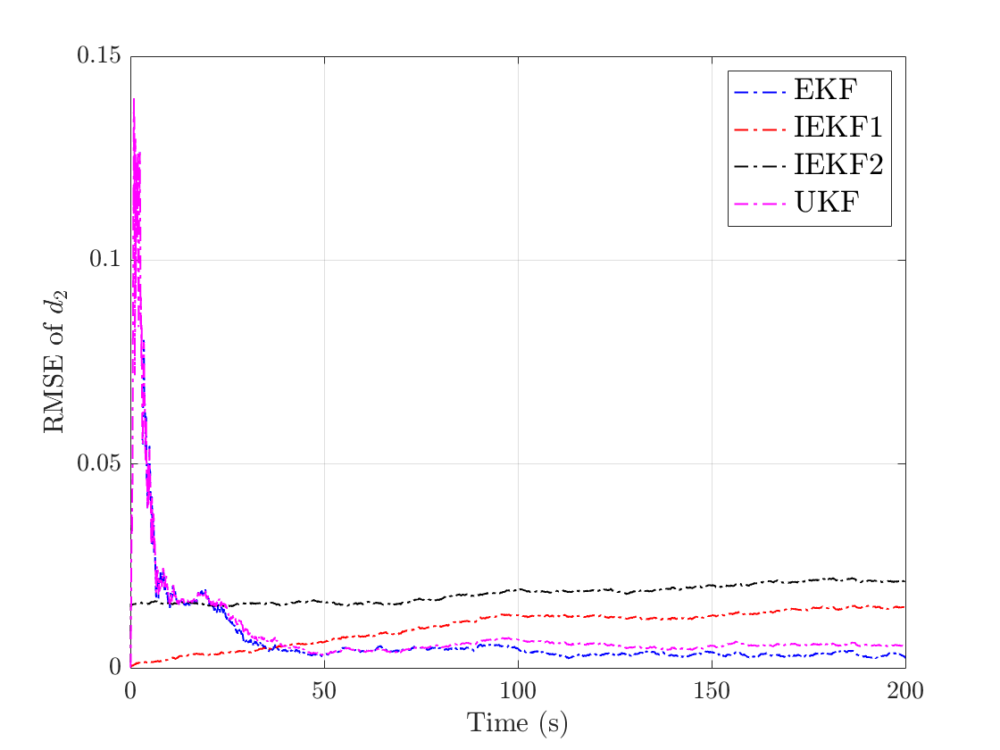

The extended Kalman filter (EKF) is the workhorse of state estimation, but it linearizes the dynamics around the current estimate and offers no global convergence guarantees. The <strong>invariant EKF (IEKF)</strong> is a symmetry-preserving alternative: by defining the estimation errors in coordinates that respect the symmetries of the system, its error dynamics depend only on the error itself and a set of invariants, not on the trajectory. In this project, I implemented the EKF, the unscented Kalman filter (UKF) and the IEKF for a unicycle robot, and reproduced two IEKF designs for estimating the state together with additive disturbances.

## The problem

The robot is a unicycle with position $$(x, y)$$, heading $$\theta$$, linear velocity $$v$$ and turning rate $$\omega$$, subject to a disturbance $$d \in \mathbb{R}^4$$ with linear dynamics:

$$
\dot x = v\cos\theta + C_x d, \qquad
\dot y = v\sin\theta + C_y d, \qquad
\dot\theta = \omega, \qquad
\dot d = A d .
$$

Only noisy measurements of the position $$(x, y)$$ are available. The pose $$(x, y, \theta)$$ evolves on the special Euclidean group $$SE(2)$$, and the system is invariant under its group actions: rotating and translating the robot leaves the form of the equations unchanged.

## Why invariant filtering

The EKF uses the plain difference between the estimate and the true state as its error. The IEKF instead uses an invariant error, in which the position error is expressed in the robot’s own frame. For the unicycle, this makes the linearized error dynamics independent of the estimated heading, so the filter does not suffer from linearizing around a poor estimate. The undisturbed example shows this clearly.

When a disturbance is added, the system stays invariant only if the disturbance transforms appropriately under the group action. Two designs achieve this: in **IEKF 1**, the disturbance itself is left unchanged and the input matrices $$C_x, C_y$$ are transformed with the robot; in **IEKF 2**, the disturbance is rotated with the robot and the input matrices stay fixed, which requires additional conditions on the disturbance dynamics.

## Results

  

    <button type="button" data-tab="undisturbed">Without disturbance</button>
    <button type="button" data-tab="disturbed">With disturbance</button>
  

  

    

      <figure><figcaption>Position error (x)</figcaption></figure>
      <figure><figcaption>Heading error (θ)</figcaption></figure>
    

    
Without disturbance, the <strong>IEKF clearly outperforms the EKF and UKF</strong>: its position error stays lower throughout the run, and its heading error stays small from the start, while the EKF and UKF show a large transient.

  

  

    

      <figure><figcaption>Heading error (θ)</figcaption></figure>
      <figure><figcaption>Disturbance error (d₂)</figcaption></figure>
    

    
With disturbance, both IEKF designs avoid the large initial transient of the EKF and UKF in the heading and disturbance estimates. In the long run, however, the EKF and UKF reach slightly lower disturbance errors, so this example only partially reproduces the results reported in the original paper.

  

Click any figure to enlarge it.

## Takeaways

- Invariant filtering exploits the symmetry of the system: it is consistent with the system’s geometry, makes convergence easier to analyze, and can significantly improve performance.
- It is not applicable to every estimation problem, there is no systematic recipe for choosing the transformations, and in my experiments the IEKF was sensitive to the process noise.
