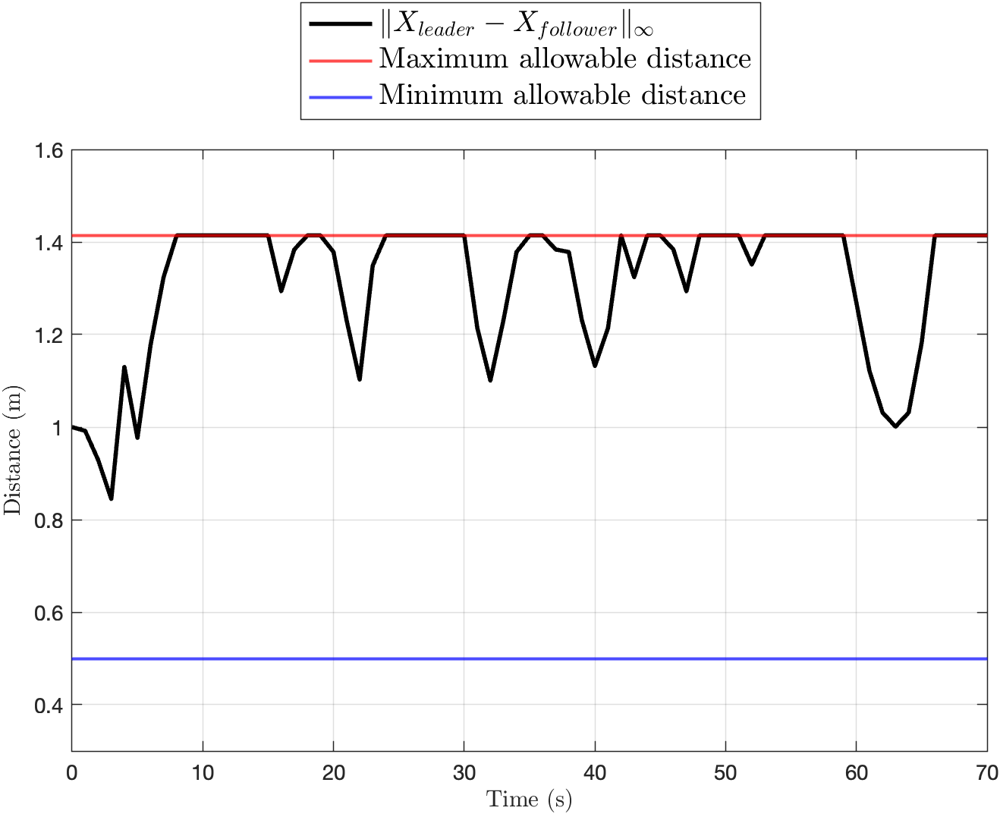
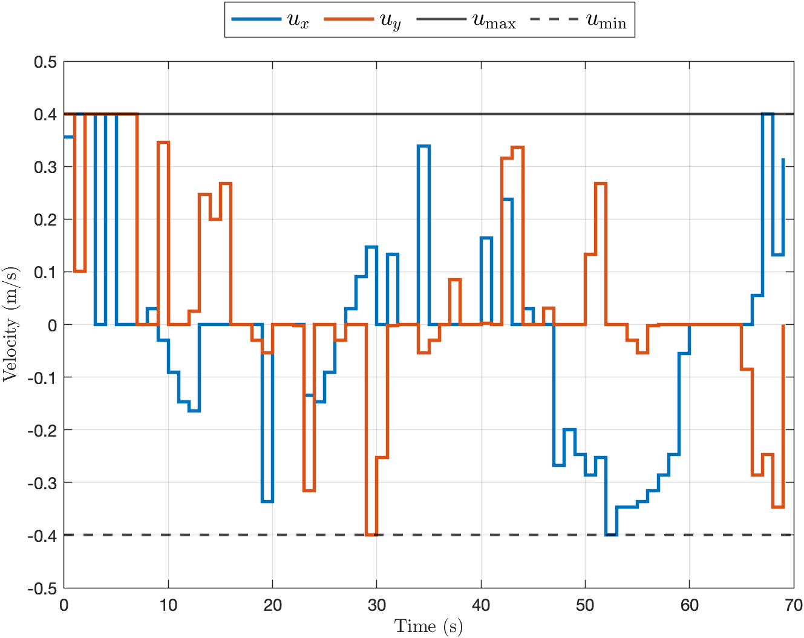

In a surveillance mission, a leader robot patrols a circle, and a follower must stay close enough that the team does not separate, but never so close that they collide. On top of that, the follower has its own task: it must visit a goal region within the first minute. Requirements like these, which combine <strong>logic</strong> (and, or) with <strong>time</strong> (eventually, always), are naturally written in <strong>signal temporal logic (STL)</strong>. In this project, I encoded the specifications as constraints of a <strong>mixed-integer program</strong> and solved for the follower’s whole trajectory at once.



## Specifications

The follower is a point that moves with bounded velocity, $$x_{t+1} = x_t + u_x\,\Delta t$$ and $$y_{t+1} = y_t + u_y\,\Delta t$$, with $$\lvert u_x \rvert, \lvert u_y \rvert \le 0.4$$ m/s. Its task is the STL formula

$$
\begin{aligned}
\varphi = {} & \mathbf{F}_{[0,60]}\big(p_f \in \text{goal}\big) \\
& \wedge\ \mathbf{G}_{[0,T]}\big(\|p_f - p_l\|_\infty \le \sqrt{2}\big) \ \wedge\ \mathbf{G}_{[0,T]}\big(\|p_f - p_l\|_\infty \ge 0.5\big),
\end{aligned}
$$

where $$p_f$$ and $$p_l$$ are the positions of the follower and the leader, $$\mathbf{F}$$ means *eventually* and $$\mathbf{G}$$ means *always*. The goal is a rectangle, so being in it is a conjunction of four linear inequalities. Keeping the follower within a square of half-width $$\sqrt{2}$$ around the leader guarantees a separation of at most $$2$$ m, and staying out of the square of half-width $$0.5$$ guarantees at least $$0.5$$ m. The first square is a conjunction of linear constraints, but the second is a **disjunction**: the follower must be to the left, to the right, above *or* below the keep-out square.

## Mixed-integer encoding

Each linear predicate $$\mu(t) \ge 0$$ gets a binary variable $$z_\mu(t)$$ that equals $$1$$ exactly when the predicate holds, enforced with the big-M method:

$$
\mu(t) \le M z_\mu(t) - \epsilon, \qquad -\mu(t) \le M\big(1 - z_\mu(t)\big) - \epsilon .
$$

The logical and temporal operators then become linear inequalities between binary variables. A conjunction is bounded above by each of its parts, a disjunction is bounded below by each of its parts, and *eventually* and *always* are a disjunction and a conjunction over time. Requiring the binary variable of the whole formula to equal $$1$$ turns the specification into the constraints of a mixed-integer linear program over the follower’s trajectory. Among all trajectories that satisfy the specification, I looked for the one with the least control effort, $$\sum_t \big(\lvert u_x(t) \rvert + \lvert u_y(t) \rvert\big)$$, and solved the problem with YALMIP and MOSEK.

## Results

The follower satisfies every requirement over the whole $$70$$-second horizon: its distance to the leader stays between the two limits, its velocities stay within their bounds, and it reaches the goal region at $$t = 60$$ s. To save effort, the follower moves as little as possible: it waits near the middle of the circle while the leader goes around it, staying close to the largest allowed distance, and then heads straight for the goal.

  <figure><figcaption>Distance to the leader (∞-norm)</figcaption></figure>
  <figure><figcaption>Velocity commands</figcaption></figure>

Click any figure to enlarge it.

## Takeaways

- Signal temporal logic gives a precise language for tasks that mix timing and logic, such as “eventually visit the goal while always keeping a safe distance.”
- With binary variables, both the logical and the temporal operators become linear constraints, so standard mixed-integer solvers can plan trajectories that satisfy the specification by construction.
- The disjunctions, choosing on which side to pass the leader and when to visit the goal, are what make the problem combinatorial; without them it would be a linear program.
