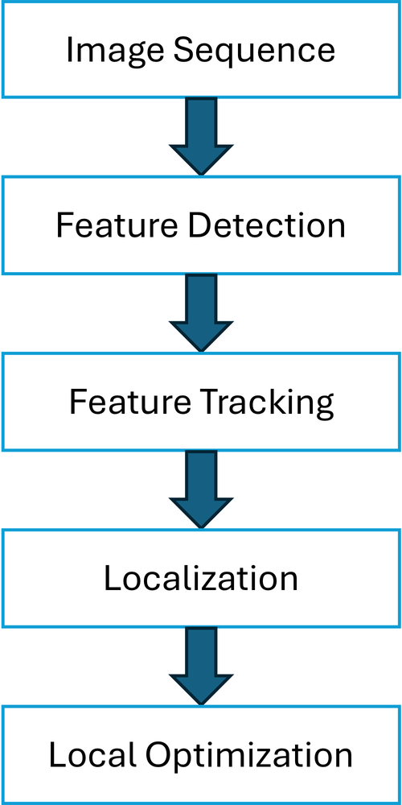
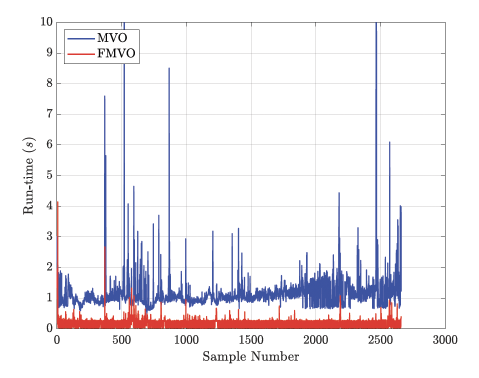
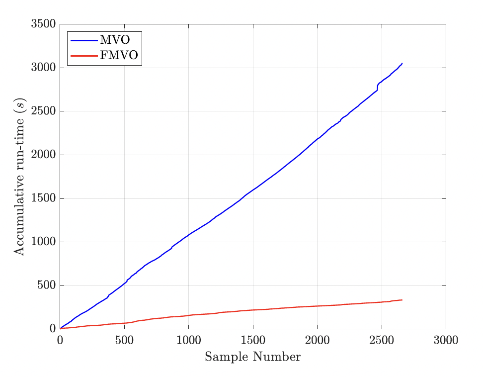

Monocular visual odometry (MVO) estimates the position (up to scale) and orientation of a robot using only the images from a single onboard camera. Cameras are cheap and informative, which makes MVO attractive when GPS is unavailable, but the conventional pipeline is computationally expensive for resource-constrained robots such as small drones. In this project, we implemented a conventional MVO pipeline and a <strong>Fast MVO (FMVO)</strong> that changes how features are managed, making it about <strong>\(20\) times faster</strong> with comparable position accuracy.

This was joint work with Milad Alipour Shahraki.

## How visual odometry works

<figure class="project-figure figure-side"><figcaption>The MVO pipeline.</figcaption></figure>

Corners are detected in an image and tracked into the next one. From the tracked correspondences, the essential matrix is estimated with the eight-point algorithm and decomposed into the relative rotation and translation of the camera, choosing the solution that places the triangulated points in front of both cameras. A local optimization then refines the poses and 3D points by minimizing the reprojection error.

In the conventional MVO, features lost during tracking are replaced by extracting new features in every image, and the optimization runs for every pair of frames. In the **FMVO**, features are extracted only at keyframes: the current set of features is tracked until fewer than a threshold ($$50$$ in our experiments) remain, at which point the remaining features are used in a local optimization and new features are extracted. Since feature extraction is one of the most expensive steps, this simple change significantly reduces the computation time.

## Results

Both algorithms were tested on sequence MH_01 of the EuRoC MAV dataset, using the ground truth only to recover the scale. The table reports the median RMSE of position and orientation and the median run-time per iteration.

<table class="project-table is-centered">
  <thead><tr><th>Metric</th><th>MVO</th><th>FMVO</th></tr></thead>
  <tbody>
    <tr><td>x RMSE (m)</td><td>2.76</td><td class="best">2.72</td></tr>
    <tr><td>y RMSE (m)</td><td>5.62</td><td class="best">5.14</td></tr>
    <tr><td>z RMSE (m)</td><td>9.66</td><td class="best">9.31</td></tr>
    <tr><td>Roll φ RMSE (°)</td><td class="best">0.94</td><td>3.99</td></tr>
    <tr><td>Pitch θ RMSE (°)</td><td class="best">0.35</td><td>1.42</td></tr>
    <tr><td>Yaw ψ RMSE (°)</td><td class="best">0.50</td><td>2.77</td></tr>
    <tr><td>Run-time per iteration (s)</td><td>1.03</td><td class="best">0.05</td></tr>
  </tbody>
</table>

The FMVO matches the conventional MVO in position accuracy and is slightly less accurate in orientation, while running about $$20$$ times faster. The gap is clear in the run-time of each iteration and in the accumulated run-time over the whole sequence:

  <figure><figcaption>Run-time per iteration</figcaption></figure>
  <figure><figcaption>Accumulated run-time</figcaption></figure>

Both methods drift over time, as visual odometry accumulates error. Fusing the camera with other sensors such as an IMU addresses both the drift and the scale ambiguity, which is the idea behind visual-inertial odometry.
