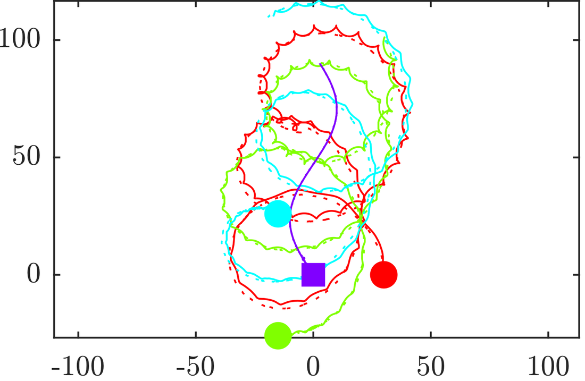
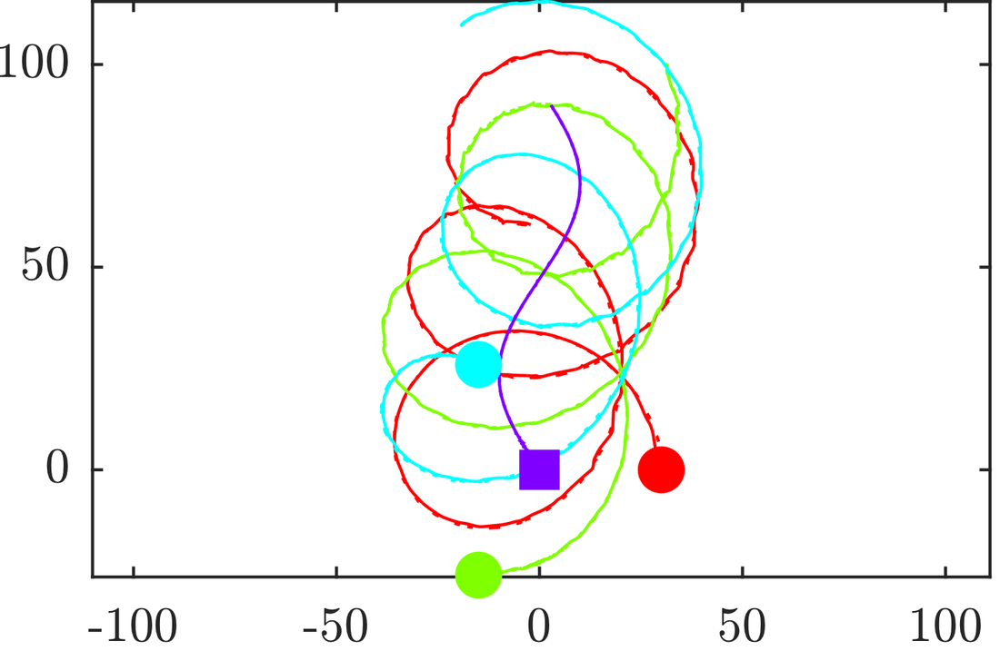
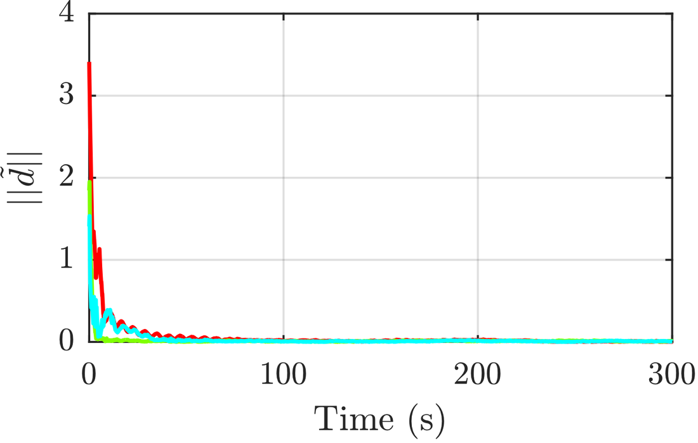
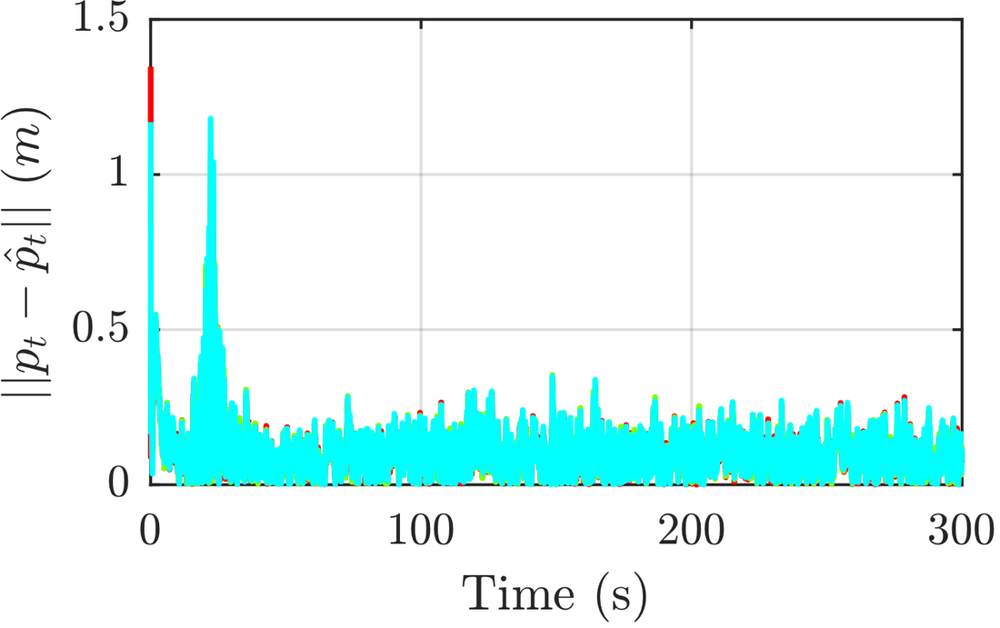
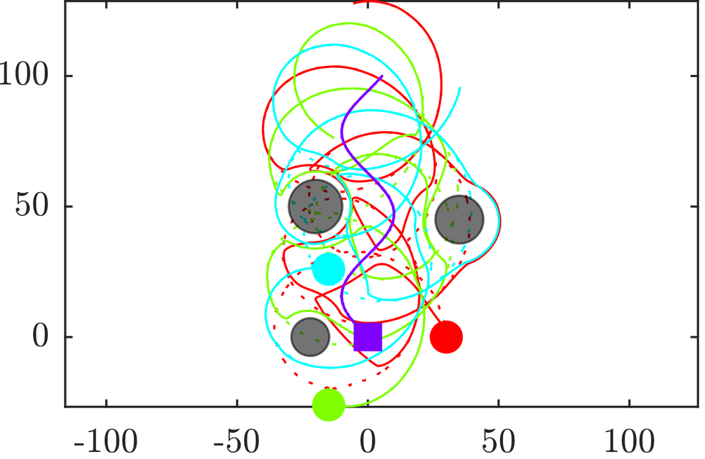
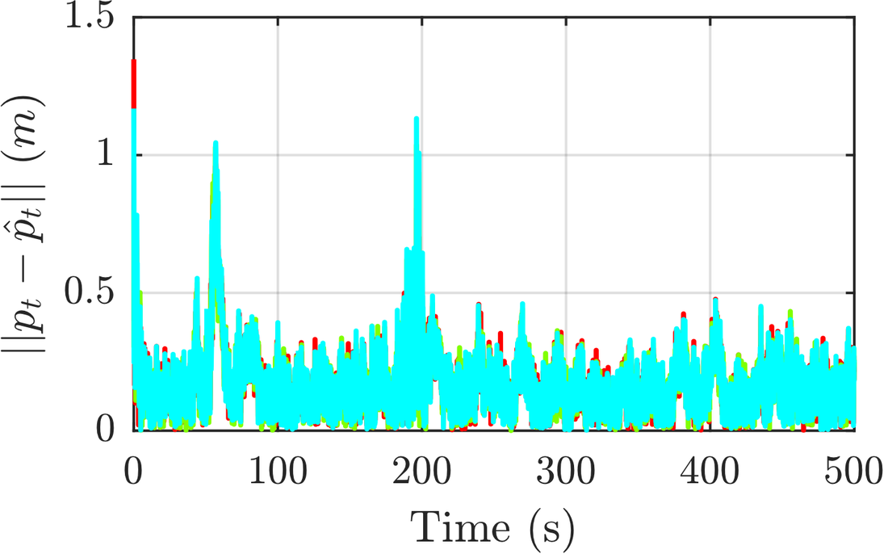

How should a team of robots move to localize a moving target as accurately as possible, using only noisy distance measurements? In this project, agents equipped with range-only sensors <strong>track a moving target in an optimal formation</strong>, share their estimates with their neighbors, and do so in two challenging settings: under <strong>external disturbances</strong> acting on the agents, and in an environment with <strong>obstacles</strong> that must be avoided.

This was joint work with Milad Alipour Shahraki.



## Approach

**Optimal formation.** Localization accuracy is measured by the determinant of the Fisher information matrix of the range measurements, which for $$n_a$$ agents is proportional to $$\sum_{i<j} \sin^2\beta_{ij}$$, where $$\beta_{ij}$$ is the angle between agents $$i$$ and $$j$$ as seen from the target. It is maximized when two agents are perpendicular with respect to the target, and when three or more agents are spread uniformly on a circle around it. Each agent therefore follows a desired trajectory that circles the estimated target position, with phase offsets $$2\pi/n_a$$ and a common angular velocity.

**Distributed estimation.** Each agent estimates the target’s position and velocity with an information-form EKF and fuses its information with that of its neighbors, so that no central processor is needed.

**Tracking control.** A Lyapunov-based feedback controller drives each agent to its desired trajectory. The tracking error converges to a small neighborhood of the origin when the estimation errors are bounded, and exponentially to zero when they vanish.

## Rejecting disturbances

When external disturbances $$d$$, with known linear dynamics $$\dot d = A d$$, act on the agents, a second EKF on each agent estimates its own state together with the disturbance, and the estimate is fed back to the controller to cancel it. Without this estimate, the agents drift away from their desired trajectories; with it, they follow them closely and the disturbance estimation error quickly goes to zero.

  <figure><figcaption>Without disturbance estimation</figcaption></figure>
  <figure><figcaption>With disturbance estimation</figcaption></figure>
  <figure><figcaption>Disturbance estimation error</figcaption></figure>
  <figure><figcaption>Target position estimation error</figcaption></figure>

Dotted lines are the desired trajectories and solid lines the actual ones. Click any figure to enlarge it.

## Avoiding obstacles

The desired circular trajectories inevitably cross obstacles. To guarantee safety, a control barrier function (CBF) is defined for each obstacle (and for each other agent) from the distance between the obstacle and a point slightly ahead of the agent’s center,

$$
B_i(x) = (x_a + l\cos\theta_a - x_{O_i})^2 + (y_a + l\sin\theta_a - y_{O_i})^2 - r_i^2 ,
$$

where $$r_i$$ is the safe distance. Using a point ahead of the center keeps the turning rate in the constraint, so the filter can steer as well as slow down. At each time step, a quadratic program finds the input closest to the nominal tracking controller that keeps every barrier function nonnegative:

$$
\min_{u} \ \|u - u_{\text{nominal}}\|^2
\quad \text{s.t.} \quad L_f B_i(x) + L_g B_i(x)\,u \ge -\alpha\big(B_i(x)\big), \quad u_{\min} \le u \le u_{\max}.
$$

The agents avoid all obstacles and each other while keeping the target estimation error small, with only brief spikes when an obstacle forces them away from their formation.

  <figure><figcaption>Trajectories with obstacles</figcaption></figure>
  <figure><figcaption>Target position estimation error</figcaption></figure>

## Takeaways

- Formation geometry matters: placing range-only sensors according to the Fisher information gives accurate localization with very few agents.
- Estimating the disturbance and feeding it back is far more effective than treating it as noise.
- A CBF safety filter adds provable collision avoidance on top of any nominal controller at the cost of a small quadratic program per step, with only a temporary loss of tracking performance near obstacles.
