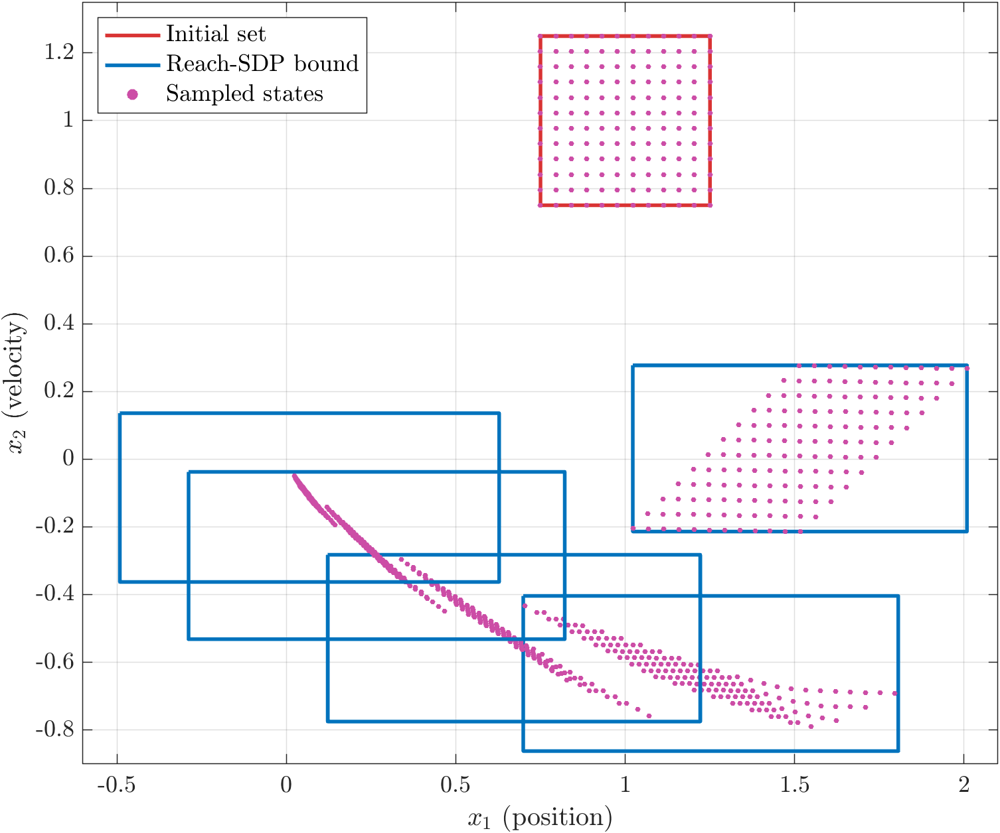
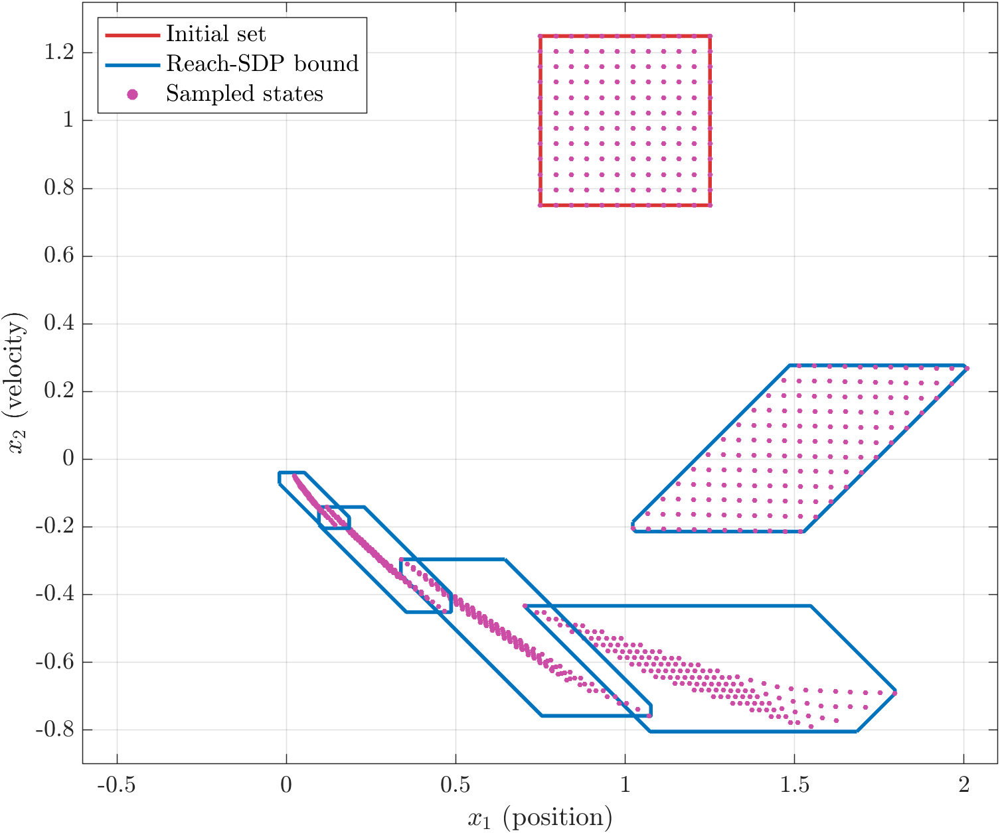
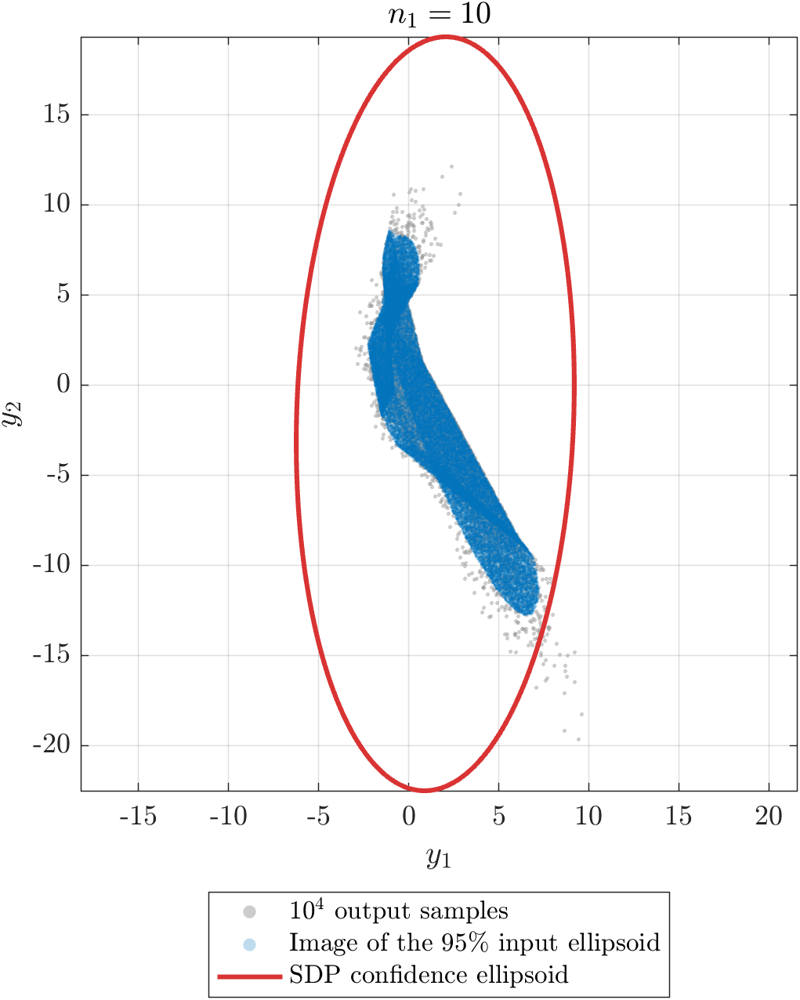
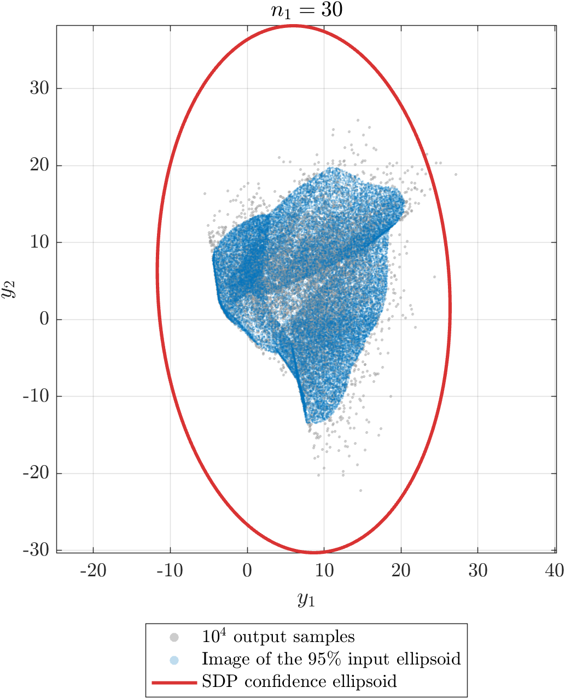
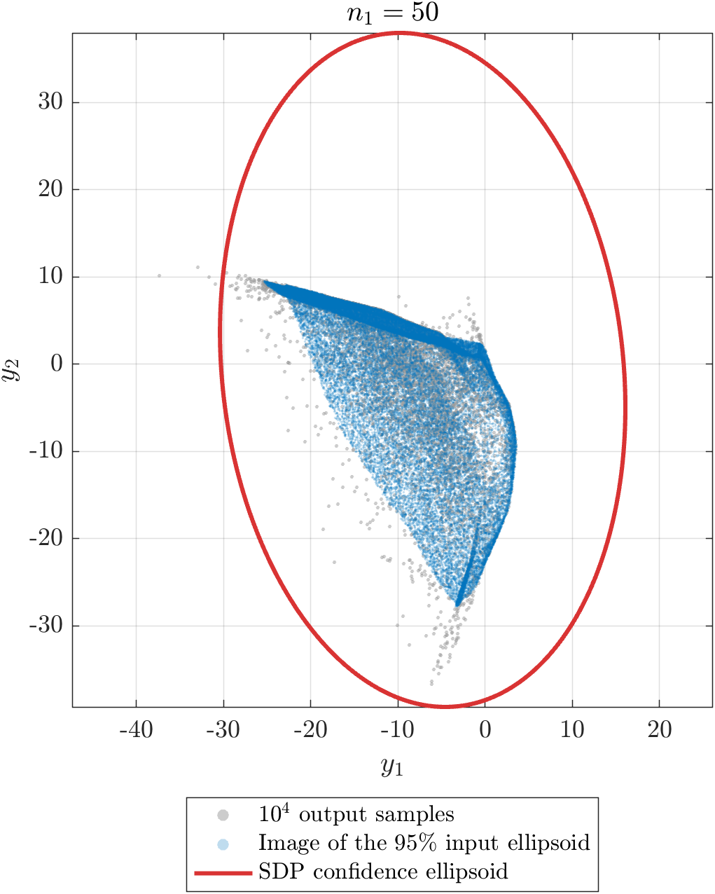
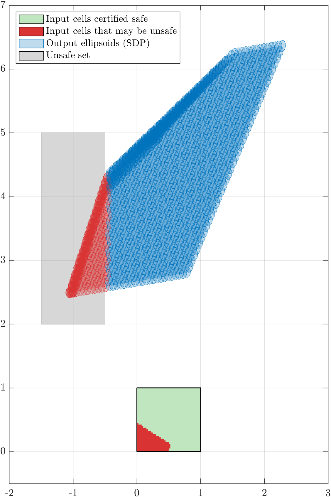

Neural networks are increasingly used as controllers, but a network trained to imitate a good controller comes with no guarantee: a small change in its input can produce an unexpected output. Before such a controller can be trusted in a safety-critical system, we need to know <strong>every state the closed-loop system can reach</strong> from a set of initial conditions. Computing this set exactly is intractable, but it can be <strong>over-approximated</strong> by a semidefinite program (SDP). In this project, I implemented Reach-SDP for networks of any depth and width, studied how its accuracy and cost depend on its design choices, and implemented the probabilistic counterpart that bounds the output of a network whose input is random.

## Quadratic constraints for ReLU networks

The difficulty is the activation function. A ReLU neuron $$y = \max(0, x)$$ is described exactly by the constraints

$$
y \ge 0, \qquad y \ge x, \qquad y\,(y - x) = 0,
$$

and any two neurons $$i$$ and $$j$$ also satisfy $$(y_j - y_i)^2 \le (y_j - y_i)(x_j - x_i)$$, because the ReLU is slope-restricted between $$0$$ and $$1$$. A weighted sum of these constraints, with nonnegative weights for the inequalities, is a single **quadratic constraint** that holds for every input and output of the layer:

$$
\begin{bmatrix} x \\ y \\ 1 \end{bmatrix}^{\!\top}
\begin{bmatrix} 0 & T & -\nu \\ T & -2T & \nu + \eta \\ -\nu^\top & \nu^\top + \eta^\top & 0 \end{bmatrix}
\begin{bmatrix} x \\ y \\ 1 \end{bmatrix} \ge 0,
\qquad
T = \sum_i \lambda_i e_i e_i^\top + \sum_{i<j} \lambda_{ij} (e_i - e_j)(e_i - e_j)^\top ,
$$

with $$\nu, \eta \ge 0$$ and $$\lambda_{ij} \ge 0$$. The input set and the candidate output set are written as quadratic inequalities in the same way. If a weighted sum of the input and network constraints implies the output inequality (the S-procedure), the output set is guaranteed to contain every output. This condition is a **linear matrix inequality** in the weights, so the tightest output set of a given shape is found by an SDP.

## Closed-loop reachability

For a linear system $$x_{t+1} = A x_t + B\,\pi(x_t)$$ in feedback with a ReLU network $$\pi$$, **Reach-SDP** computes an over-approximation of the reachable set one step at a time: the set at step $$t$$ is the input set of the SDP for step $$t + 1$$. The output set is a polytope with given facet directions $$a_i$$, and each SDP finds the smallest offset $$b_i$$ such that $$a_i^\top x_{t+1} \le b_i$$ for every reachable state. My implementation works with any linear system and any number and size of hidden layers. It builds the network constraint from **one block per layer**, as in Fazlyab, Morari and Pappas (2021), so the cross terms $$\lambda_{ij}$$ couple only neurons of the same layer.

The example is a double integrator with a network of two hidden layers ($$15$$ and $$10$$ neurons) trained to imitate a model predictive controller, starting from the square of half-width $$0.25$$ around $$(1, 1)$$.

  

    <button type="button" data-tab="box">Boxes</button>
    <button type="button" data-tab="octagon">Octagons</button>
  

  

    <figure class="project-figure" style="max-width: 640px; margin-left: auto; margin-right: auto;"><figcaption>Reachable sets over-approximated by boxes, for \(5\) steps, with \(144\) sampled initial states and their trajectories.</figcaption></figure>
  

  

    <figure class="project-figure" style="max-width: 640px; margin-left: auto; margin-right: auto;"><figcaption>The same sets over-approximated by octagons (axis-aligned and diagonal facets).</figcaption></figure>
  

Every sampled state lies inside its bound at every step, as the theory guarantees. The first step is exact: the box has the same width as the true reachable set. After that, the box bounds stop shrinking even though the true sets do. The reason is not the SDP but the **wrapping effect**: the true set is a thin diagonal sliver, and wrapping it in a box at every step adds empty corners that are propagated and grow at the next step. Adding the four diagonal facets removes most of this, at about twice the cost:

<table class="project-table is-centered">
  <thead>
    <tr><th>Step</th><th>True set</th><th>Box</th><th>Octagon</th></tr>
  </thead>
  <tbody>
    <tr><td>1</td><td>0.986 × 0.490</td><td>0.986 × 0.491</td><td>0.986 × 0.491</td></tr>
    <tr><td>2</td><td>1.093 × 0.359</td><td>1.107 × 0.459</td><td>1.093 × 0.372</td></tr>
    <tr><td>3</td><td>0.732 × 0.462</td><td>1.099 × 0.493</td><td>0.738 × 0.462</td></tr>
    <tr><td>4</td><td>0.347 × 0.307</td><td>1.110 × 0.494</td><td>0.390 × 0.311</td></tr>
    <tr><td>5</td><td>0.121 × 0.145</td><td>1.120 × 0.498</td><td>0.206 × 0.164</td></tr>
  </tbody>
</table>

Width × height of the true reachable set (from dense sampling) and of its over-approximations.

I also compared three structures of the network constraint: cross terms between **all** pairs of neurons (as in the original Reach-SDP), cross terms only **within each layer** (my implementation), and **no** cross terms. For the double integrator and for a quadrotor with two hidden layers of $$32$$ neurons, all three gave exactly the same bounds, while the solver time grew with the number of multipliers:

<table class="project-table is-centered">
  <thead>
    <tr><th>Cross terms</th><th>Double integrator (5 steps)</th><th>Quadrotor (2 steps)</th></tr>
  </thead>
  <tbody>
    <tr><td>All pairs of neurons</td><td>1.23 s</td><td>73.5 s</td></tr>
    <tr><td>Within each layer</td><td>0.50 s</td><td>23.6 s</td></tr>
    <tr><td>None</td><td class="best">0.26 s</td><td class="best">2.1 s</td></tr>
  </tbody>
</table>

MOSEK solver time, with the same bounds in every case.

## Probabilistic reachability

If the input of a network is random rather than bounded, a worst-case bound may be unnecessarily conservative, or impossible when the input distribution is unbounded. Fazlyab, Morari and Pappas instead propagate a **confidence region**: if $$x$$ lies in an ellipsoid $$\mathcal{E}_p$$ with probability at least $$p$$ (for a Gaussian input, $$\mathcal{E}_p$$ is given by the $$\chi^2$$ quantile; with only the mean and covariance known, by Chebyshev’s inequality), then any set containing $$f(\mathcal{E}_p)$$ contains the output $$f(x)$$ with probability at least $$p$$. The smallest such ellipsoid $$\{y : \lVert A y + b \rVert \le 1\}$$ is found with the same quadratic constraints, by an SDP that maximizes $$\log\det A$$.

I reproduced the experiment of the paper: networks with $$2$$ inputs, one hidden layer of $$n_1 \in \{10, 30, 50\}$$ neurons and $$2$$ outputs, with random weights, and a Gaussian input with mean $$(1, 1)$$ and covariance $$\mathrm{diag}(1, 2)$$.

  

    <button type="button" data-tab="n10">10 neurons</button>
    <button type="button" data-tab="n30">30 neurons</button>
    <button type="button" data-tab="n50">50 neurons</button>
  

  
<figure class="project-figure" style="max-width: 440px; margin-left: auto; margin-right: auto;"></figure>

  
<figure class="project-figure" style="max-width: 440px; margin-left: auto; margin-right: auto;"></figure>

  
<figure class="project-figure" style="max-width: 440px; margin-left: auto; margin-right: auto;"></figure>

Gray: outputs for \(10^4\) random inputs. Blue: the image of the \(95\%\) input confidence ellipsoid. Red: the \(95\%\) output confidence ellipsoid computed by the SDP.

The estimated ellipsoids are valid: they contain $$99.70\%$$, $$99.96\%$$ and $$99.94\%$$ of the samples, more than the required $$95\%$$. They are also conservative, as in the paper, because a single ellipsoid must cover the whole image of the input ellipsoid, which is far from elliptical.

## Verification by partitioning the input

The same SDP can answer a safety question: which inputs in the square $$[0, 1]^2$$ can drive a network (one hidden layer of $$5$$ neurons) into an unsafe region of its output space? A single ellipsoid around the whole output set would be far too conservative, so I split the input square into $$40 \times 40$$ cells, enclosed each cell in an ellipse, and computed a guaranteed output ellipsoid for each cell. A cell is certified safe if its output ellipsoid does not touch the unsafe set.

<figure class="project-figure" style="max-width: 460px; margin-left: auto; margin-right: auto;"><figcaption>The input square (bottom) and the output ellipsoids of its \(1600\) cells (top), with the unsafe set in gray.</figcaption></figure>

Of the $$1600$$ cells, $$231$$ truly map into the unsafe set (checked by dense sampling of each cell). The SDP flagged all of them, plus only $$8$$ false alarms, and every output it bounded stayed inside its ellipsoid. For comparison, I also tried a much cheaper heuristic that propagates the mean and covariance of each cell through the network, as a Kalman filter would, by linearizing each ReLU. It flagged $$37$$ false alarms, and in $$31$$ cells some outputs fell outside its ellipse, so unlike the SDP it gives no guarantee.

## Takeaways

- Quadratic constraints turn a hard question about a nonlinear network into a convex program whose answer is a guaranteed bound.
- The SDP itself can be tight (the first step of the double integrator is exact); in a multi-step analysis, most of the conservatism comes from the shape of the sets, and better facet directions help far more than richer multipliers.
- The cross terms between neurons did not tighten any of the bounds I computed, but made the SDPs up to $$35$$ times slower.
