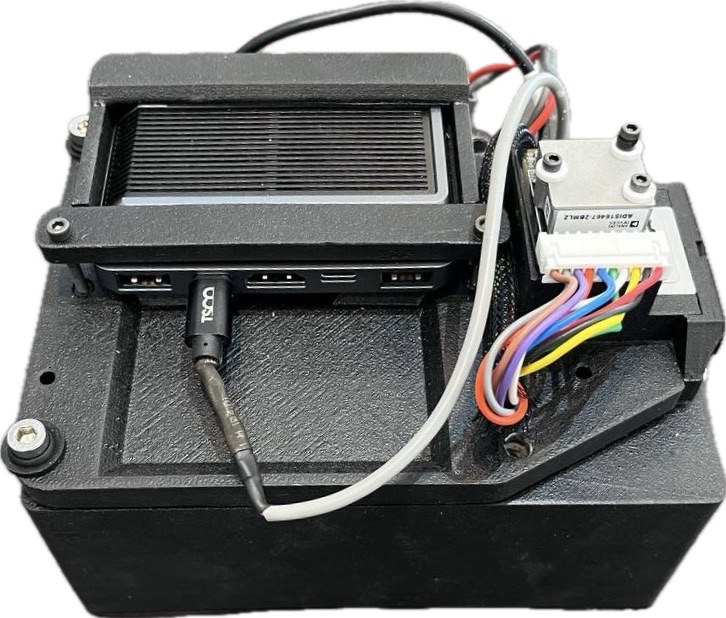
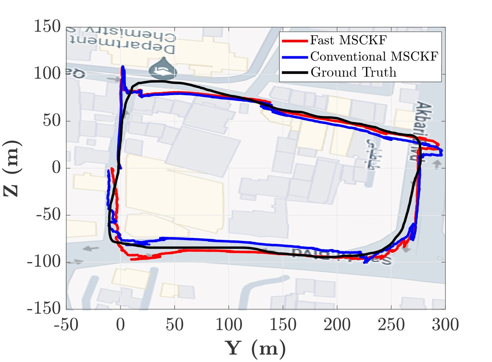
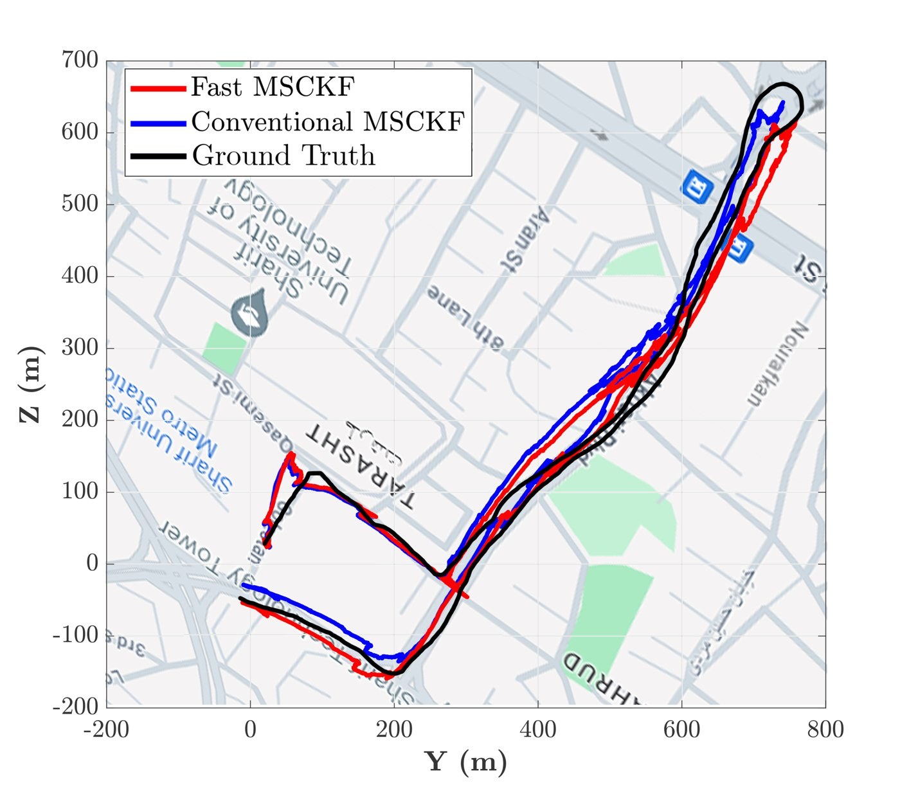

Agile robots such as quadrotors need to know their position and orientation quickly and accurately, often where satellite navigation is unavailable or unreliable: indoors, under trees, or between tall buildings. <strong>Visual-inertial odometry</strong> estimates this pose by fusing a camera with an inertial measurement unit (IMU), two sensors that are cheap, light and complementary. In my M.Sc. thesis, I developed a <strong>faster version of the multi-state constraint Kalman filter (MSCKF)</strong>, one of the most widely used visual-inertial estimators, and tested it on a public dataset and with a sensor setup we built.

## The MSCKF

The MSCKF is an error-state extended Kalman filter. The IMU measurements propagate the state (orientation, position, velocity and the sensor biases) between images. Instead of storing the positions of landmarks in the state, which would make the state grow with every new feature, the filter keeps a sliding window of recent **camera poses**. Each feature tracked across several images is triangulated and then used as a constraint between the poses that observed it, after its own position is projected out of the measurement equations. This keeps the filter small, but the image processing (extracting and tracking features in every image) remains expensive, and most of the computation goes into it.

## What makes it fast

The difference between the MSCKF and the Fast MSCKF is in how features and camera poses are managed:

- **Features are extracted only in keyframes.** The original MSCKF extracts new features in every image to keep their number constant. The Fast MSCKF extracts features once and tracks them through the following images, and only extracts new ones when fewer than $$N_{f,\min} = 8$$ features are still being tracked. That image becomes the new keyframe.
- **The window is emptied at every keyframe.** At that moment, all feature tracks are used in one update, and all camera poses except the keyframe are removed from the state, so the state and covariance stay small.

Keyframes are therefore chosen by how many features can still be tracked, not by how far the camera has moved, as in most keyframe-based methods. Updates also happen more often, before the camera poses predicted from the IMU have had time to drift, which makes the Fast MSCKF more accurate as well as faster.



## Results on the EuRoC dataset

On all eleven sequences of the EuRoC MAV dataset, the Fast MSCKF ran at $$85$$–$$118$$ Hz in MATLAB, three to four times the update rate of the MSCKF ($$25$$–$$32$$ Hz) and faster than the other well-known visual-inertial methods. On sequence MH 01, it also had the smallest final errors:

<table class="project-table is-centered">
  <thead><tr><th>Method</th><th>Update rate (Hz)</th><th>Final position error (%)</th><th>Final orientation error (°)</th></tr></thead>
  <tbody>
    <tr><td>ROVIO</td><td>38.8</td><td>0.57</td><td>2.09</td></tr>
    <tr><td>SVO (VIO)</td><td>32.5</td><td>0.98</td><td>4.86</td></tr>
    <tr><td>SVO + GTSAM</td><td>64.7</td><td>0.49</td><td>1.59</td></tr>
    <tr><td>MSCKF</td><td>28.5</td><td>0.49</td><td>1.52</td></tr>
    <tr><td>Fast MSCKF</td><td class="best">106.4</td><td class="best">0.25</td><td class="best">1.39</td></tr>
  </tbody>
</table>

## Real-world experiments

To test the filter on real data, we built a sensor setup with a global-shutter camera (Basler acA1300-200uc, $$10$$ Hz), a MEMS IMU (ADIS16467, $$100$$ Hz), an STM32 microcontroller that reads the IMU, and an NVIDIA Jetson Xavier NX that records the data. The camera and the IMU were calibrated with Kalibr.

<figure class="project-figure figure-side"><figcaption>The sensor setup</figcaption></figure>

In the first experiments, the setup was carried by hand along closed loops, so that the error at the end of the loop measures the drift: indoors in an office, and outdoors along a $$45$$ m path, where the Fast MSCKF ended $$0.14$$ m ($$0.31\%$$ of the distance) from the starting point, against $$0.24$$ m ($$0.53\%$$) for the MSCKF.

  <figure><video class="video-file" style="aspect-ratio: 1; object-fit: cover;" controls preload="none" playsinline poster="indoor-test-poster.jpg"><source src="indoor-test.mp4" type="video/mp4"></video><figcaption>Indoor loop</figcaption></figure>
  <figure><video class="video-file" style="aspect-ratio: 1; object-fit: cover;" controls preload="none" playsinline poster="outdoor-test-poster.jpg"><source src="outdoor-test.mp4" type="video/mp4"></video><figcaption>Outdoor loop, \(45\) m (\(2\times\) speed)</figcaption></figure>

The setup was then mounted on a car and driven along a $$900$$ m loop and a $$2.5$$ km path through a crowded neighborhood with many moving cars and people. The final position errors of the Fast MSCKF were $$0.38\%$$ and $$0.41\%$$ of the distance traveled, against $$0.51\%$$ and $$1.0\%$$ for the MSCKF.

  <figure><figcaption>\(900\) m loop</figcaption></figure>
  <figure><figcaption>\(2.5\) km path</figcaption></figure>

Fast MSCKF (red), MSCKF (blue) and the path reconstructed from the lanes driven (black). Click any figure to enlarge it.

## Takeaways

- In visual-inertial odometry, most of the computation goes into image processing, so managing features carefully pays off more than speeding up the filter algebra.
- Updating more often, with fewer but longer feature tracks, reduced drift as well as computation.
- Testing on our own hardware, from short hand-held loops to kilometers of urban driving, showed that the gains carry over from benchmark datasets to real conditions.
