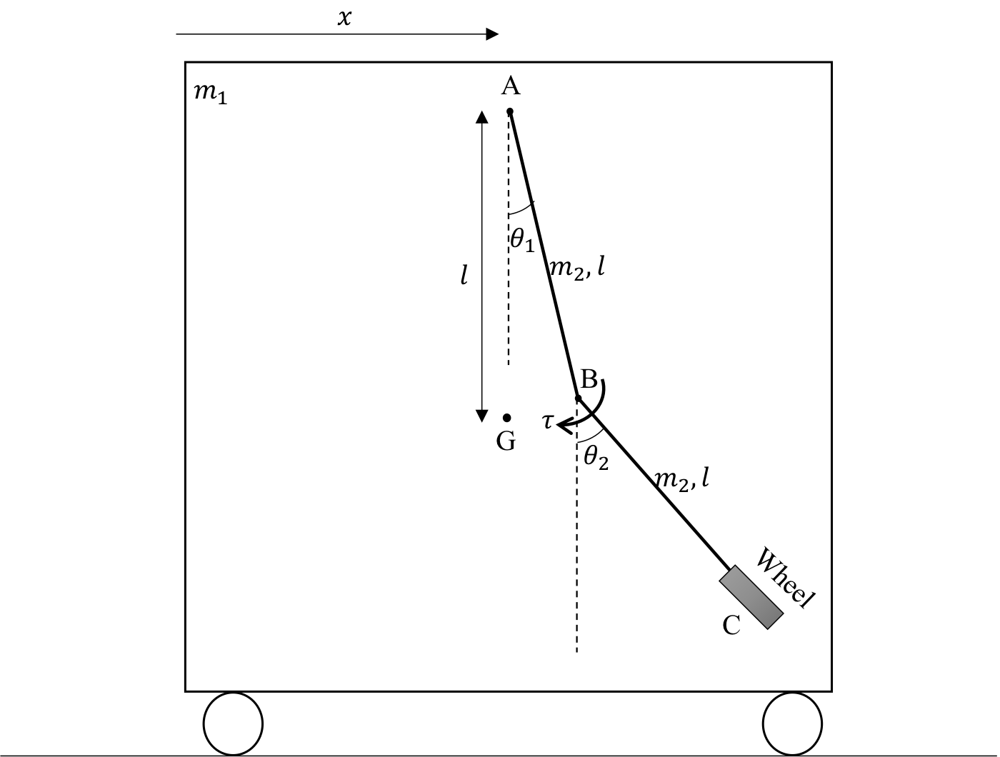
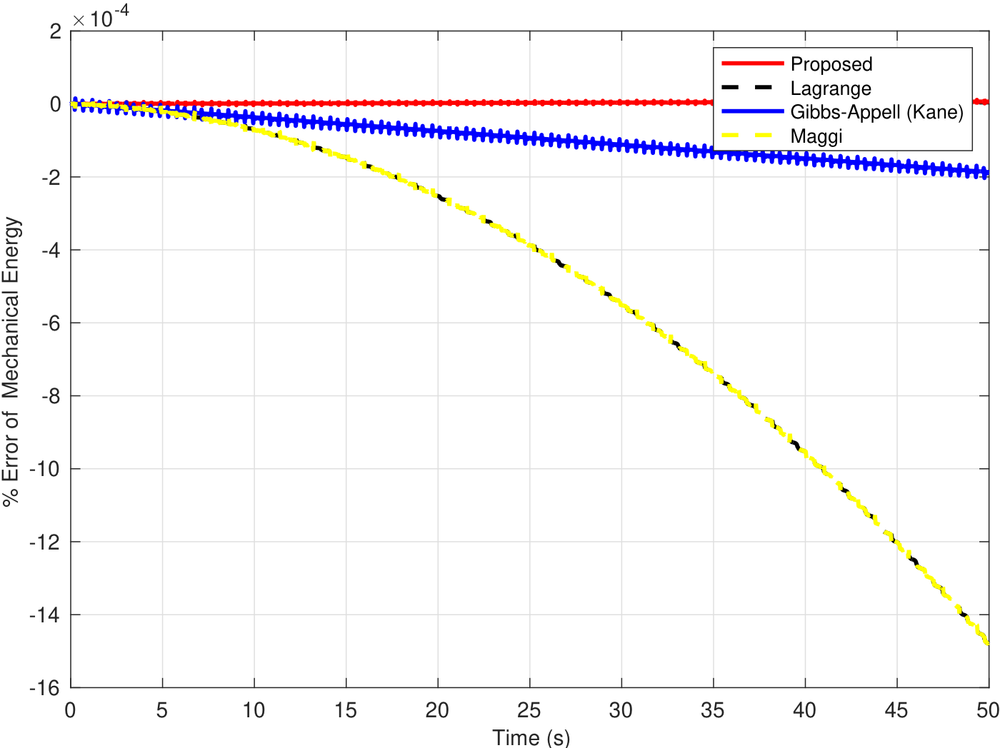
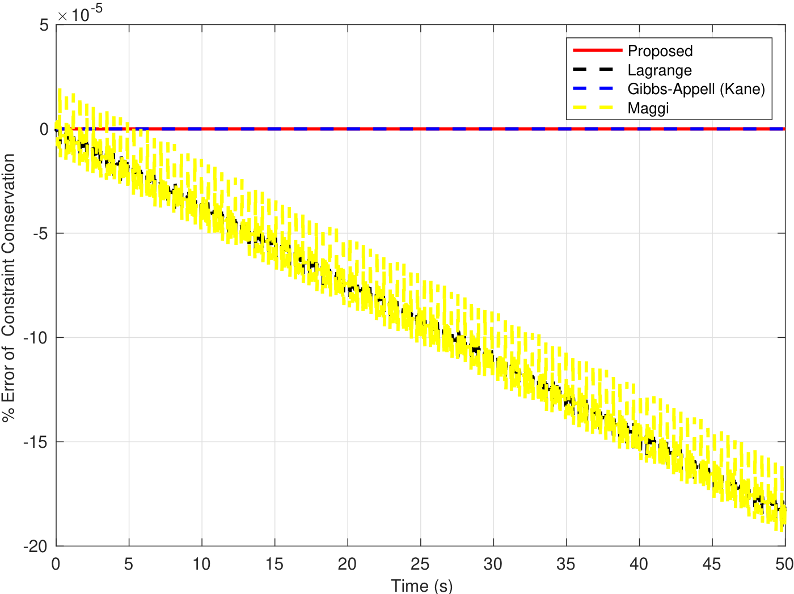
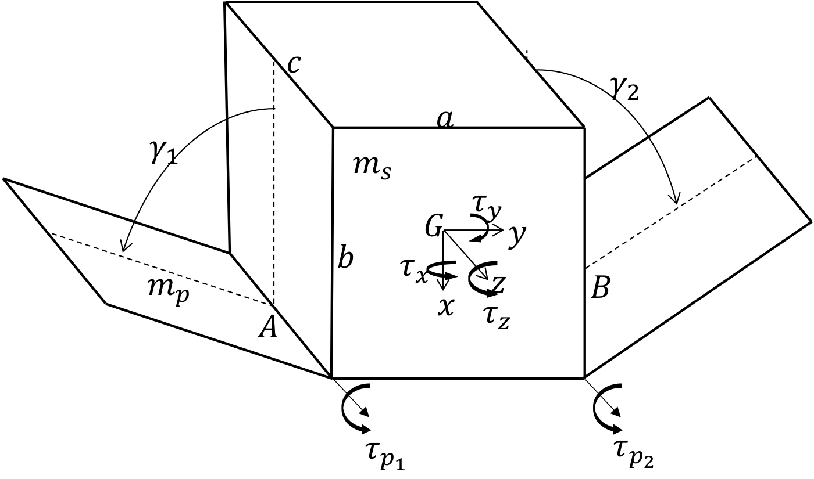
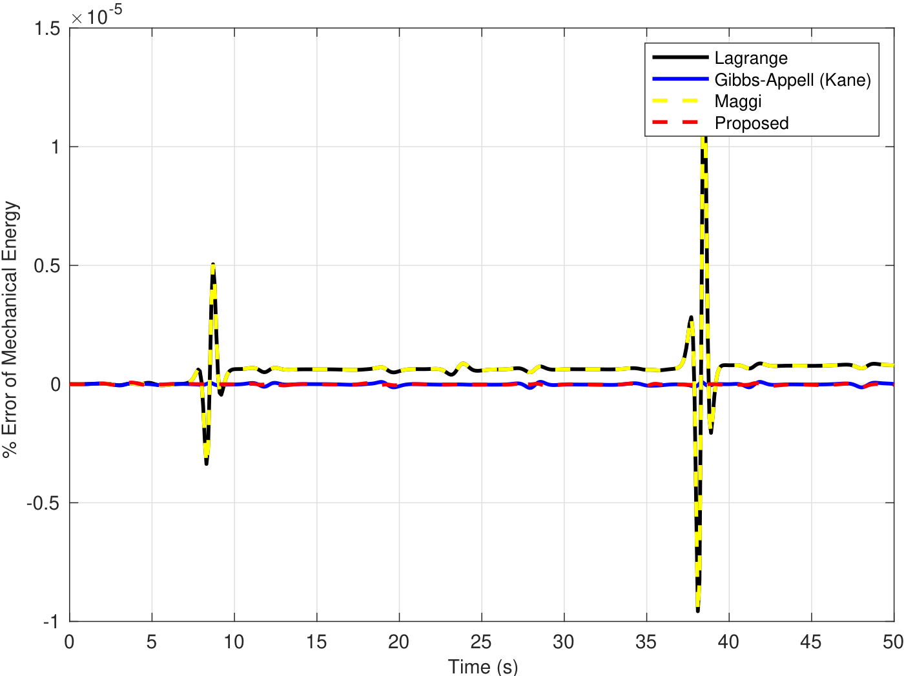
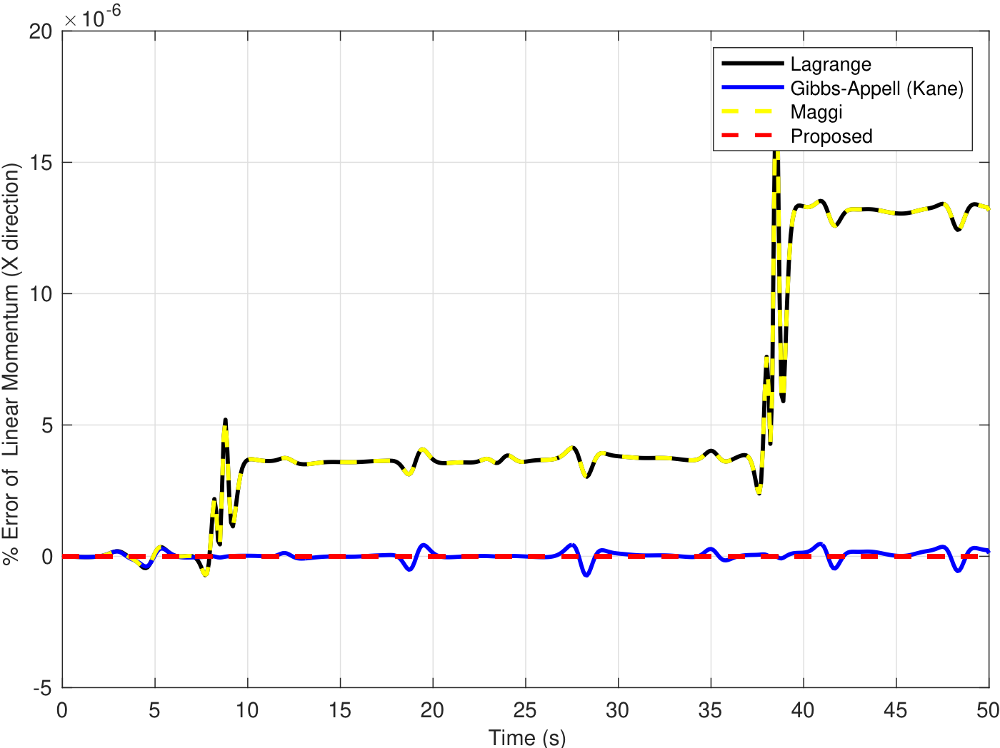
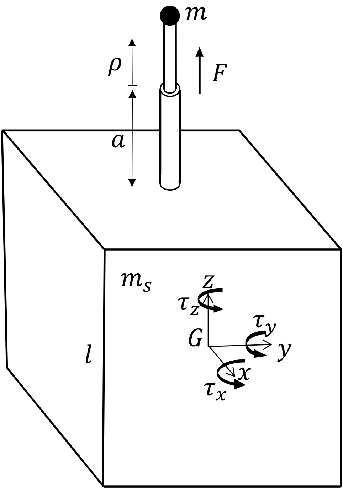
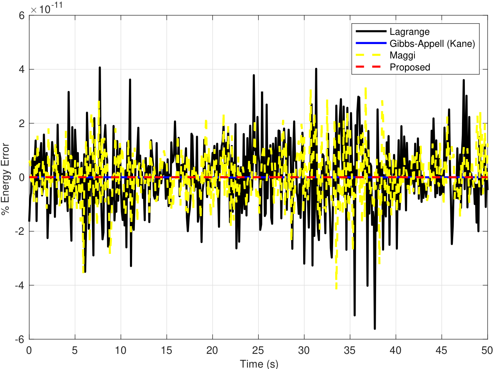
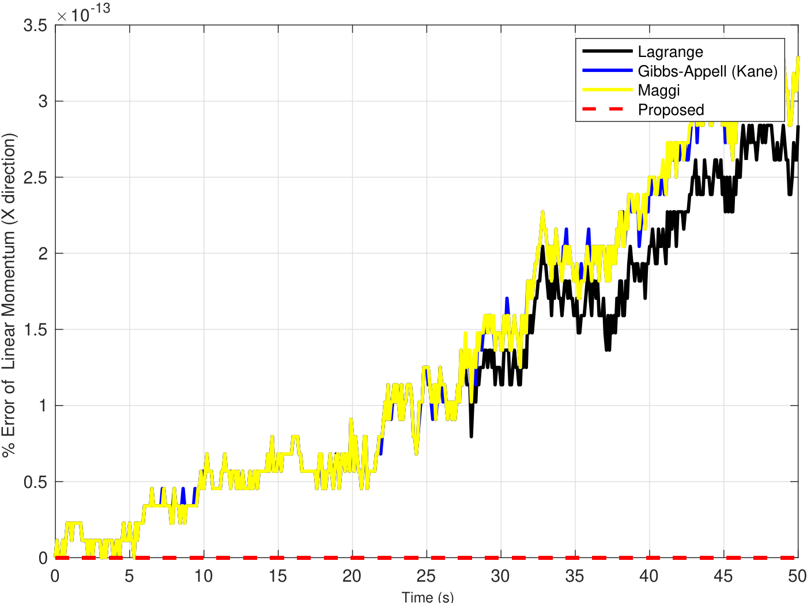

Deriving the equations of motion is the first step in simulating a multibody system. Many systems of practical interest, such as a free-floating satellite, have <strong>ignorable coordinates</strong>: coordinates that appear in neither the Lagrangian, nor the constraints, nor the generalized forces. Conventional methods still carry one equation for each of them. In this project, we developed an <strong>efficient form of Volterra’s equations of motion</strong> that removes these redundant equations and gives the <strong>minimum number of first-order equations</strong> for both constrained and unconstrained systems.

## Dynamical constraints

Split the generalized coordinates into non-ignorable and ignorable ones, $$q = [q_{NI}^\top \ q_I^\top]^\top$$. For the ignorable coordinates, Lagrange’s equations reduce to conservation of the corresponding generalized momentum:

$$
\frac{\partial T}{\partial \dot q_I} = M_{21}\,\dot q_{NI} + M_{22}\,\dot q_I + N_2 = G_I = \text{constant},
$$

where $$T$$ is the kinetic energy, $$M_{21}, M_{22}$$ are blocks of the mass matrix and $$G_I$$ is computed from the initial conditions. This equation has exactly the form of a velocity constraint, $$a\,\dot q + b = 0$$, so we treat it as one and call it a **dynamical constraint**, as opposed to the usual **kinematical constraints** that come from the geometry of the system (for example, a wheel that cannot slip).

## Efficient Volterra equations

A system with $$m$$ generalized coordinates, $$r$$ kinematical constraints and $$s$$ ignorable coordinates has $$p = m - r$$ degrees of freedom, but only $$p - s$$ equations are needed to describe its motion. We choose $$p - s$$ quasi-velocities $$u_{NI}$$, which, unlike earlier approaches, can mix ignorable and non-ignorable generalized velocities, and stack them with both kinds of constraints to write $$\dot q = W_{NI}\,u_{NI} + X_{NI}$$. Writing Volterra’s equations only for these quasi-velocities gives the state-space model

$$
\dot q = W_{NI}(t, q)\,u_{NI} + X_{NI}(t, q), \qquad M_{NI}(t, q)\,\dot u_{NI} = L_{NI}(t, q, u_{NI}),
$$

where $$M_{NI} = W_{NI}^\top M\, W_{NI}$$ is a $$(p-s)\times(p-s)$$ reduced mass matrix. Both kinds of constraints are embedded in velocity form, so they are satisfied by construction instead of being integrated, and the matrix that must be inverted at every step is smaller than in any of the conventional methods:

<table class="project-table is-centered">
  <thead><tr><th>Method</th><th>Number of equations</th></tr></thead>
  <tbody>
    <tr><td>Lagrange, Maggi, Udwadia–Kalaba</td><td>\(m\)</td></tr>
    <tr><td>Boltzmann–Hamel, Volterra, Kane (Gibbs–Appell)</td><td>\(p\)</td></tr>
    <tr><td>Routh</td><td>\(m - s\)</td></tr>
    <tr><td>Proposed (efficient Volterra)</td><td class="best">\(p - s\)</td></tr>
  </tbody>
</table>

## Case studies

We compared the proposed method with the Lagrange, Maggi and Gibbs–Appell (Kane) methods on three systems, each simulated for $$50$$ seconds with MATLAB’s `ode45`. Without external forces, the mechanical energy and the linear momentum must stay constant, so their drift measures the numerical error of each method.

  

    <button type="button" data-tab="cart">Cart with a pendulum</button>
    <button type="button" data-tab="bodies">Three connected bodies</button>
    <button type="button" data-tab="satellite">Satellite with a boom</button>
  

  

    <h4>A cart with a two-link pendulum (constrained)</h4>
    
A wheel at the tip of the pendulum cannot slip, which imposes a nonholonomic constraint. The position of the cart, \(x\), is an ignorable coordinate, so the proposed method needs a single equation.

    

      <figure><figcaption>The system</figcaption></figure>
      <figure><video class="video-file" controls preload="none" playsinline poster="case1-poster.jpg"><source src="case1.mp4" type="video/mp4"></video><figcaption>Simulation</figcaption></figure>
      <figure><figcaption>Mechanical energy drift (%)</figcaption></figure>
      <figure><figcaption>Constraint violation (%)</figcaption></figure>
    

    <table class="project-table is-centered">
      <thead><tr><th></th><th>Lagrange</th><th>Maggi</th><th>Kane</th><th>Proposed</th></tr></thead>
      <tbody>
        <tr><td>Equations</td><td>3</td><td>3</td><td>2</td><td class="best">1</td></tr>
        <tr><td>CPU time (s)</td><td>1.93</td><td>1.72</td><td>1.87</td><td class="best">1.69</td></tr>
        <tr><td>Energy error</td><td>6.1e-4</td><td>6.1e-4</td><td>9.8e-5</td><td class="best">3.6e-6</td></tr>
        <tr><td>Constraint error</td><td>7.5e-5</td><td>7.5e-5</td><td>6.5e-15</td><td class="best">0</td></tr>
        <tr><td>Momentum error</td><td>3.8e-6</td><td>3.9e-6</td><td>4.0e-5</td><td class="best">2.4e-15</td></tr>
      </tbody>
    </table>
  

  

    <h4>Three connected rigid bodies (unconstrained)</h4>
    
A central body with two hinged panels moves freely in space. It has \(8\) degrees of freedom, and the three coordinates of its center of mass are ignorable, so the proposed method needs \(5\) equations instead of 8.

    

      <figure><figcaption>The system</figcaption></figure>
      <figure><video class="video-file" controls preload="none" playsinline poster="case2-poster.jpg"><source src="case2.mp4" type="video/mp4"></video><figcaption>Simulation</figcaption></figure>
      <figure><figcaption>Mechanical energy drift (%)</figcaption></figure>
      <figure><figcaption>Linear momentum drift, X direction (%)</figcaption></figure>
    

    <table class="project-table is-centered">
      <thead><tr><th></th><th>Lagrange</th><th>Maggi</th><th>Kane</th><th>Proposed</th></tr></thead>
      <tbody>
        <tr><td>Equations</td><td>8</td><td>8</td><td>8</td><td class="best">5</td></tr>
        <tr><td>CPU time (s)</td><td>1.10</td><td>0.99</td><td>0.68</td><td class="best">0.67</td></tr>
        <tr><td>Energy error</td><td>3.0e-7</td><td>3.0e-7</td><td>9.1e-9</td><td class="best">6.4e-9</td></tr>
        <tr><td>Momentum error</td><td>1.6e-6</td><td>1.6e-6</td><td>3.8e-8</td><td class="best">0</td></tr>
      </tbody>
    </table>
  

  

    <h4>A satellite with a deployable boom (unconstrained, with input)</h4>
    
A motor extends a boom that pushes a mass away from a cubic satellite with a time-varying force. The energy is no longer constant, so the error is measured against the work done by the force. Again the position of the satellite is ignorable, and the proposed method needs \(4\) equations instead of 7.

    

      <figure><figcaption>The system</figcaption></figure>
      <figure><video class="video-file" controls preload="none" playsinline poster="case3-poster.jpg"><source src="case3.mp4" type="video/mp4"></video><figcaption>Simulation</figcaption></figure>
      <figure><figcaption>Energy error (%)</figcaption></figure>
      <figure><figcaption>Linear momentum drift, X direction (%)</figcaption></figure>
    

    <table class="project-table is-centered">
      <thead><tr><th></th><th>Lagrange</th><th>Maggi</th><th>Kane</th><th>Proposed</th></tr></thead>
      <tbody>
        <tr><td>Equations</td><td>7</td><td>7</td><td>7</td><td class="best">4</td></tr>
        <tr><td>CPU time (s)</td><td>0.59</td><td>0.53</td><td>0.50</td><td class="best">0.48</td></tr>
        <tr><td>Energy error</td><td>6.3e-14</td><td>6.2e-14</td><td>5.0e-14</td><td class="best">7.9e-15</td></tr>
        <tr><td>Momentum error</td><td>3.2e-14</td><td>3.8e-14</td><td>3.7e-14</td><td class="best">0</td></tr>
      </tbody>
    </table>
  

Errors are norms of the drift over the whole simulation. Click any figure to enlarge it.

In all three systems, the proposed method has the fewest equations, the shortest run time and the smallest errors, and it conserves the linear momentum and the constraints exactly, since they are built into the equations rather than integrated.

## Takeaways

- A conserved momentum is just another constraint: treating it like a kinematical constraint removes one equation per ignorable coordinate.
- Fewer, first-order equations with velocity-level constraints mean a smaller matrix to invert and less drift in energy, momentum and constraints.
- The run-time gains are modest for these small examples, but the reduced mass matrix shrinks from $$m \times m$$ to $$(p-s)\times(p-s)$$, so the benefit is expected to grow for larger systems.
